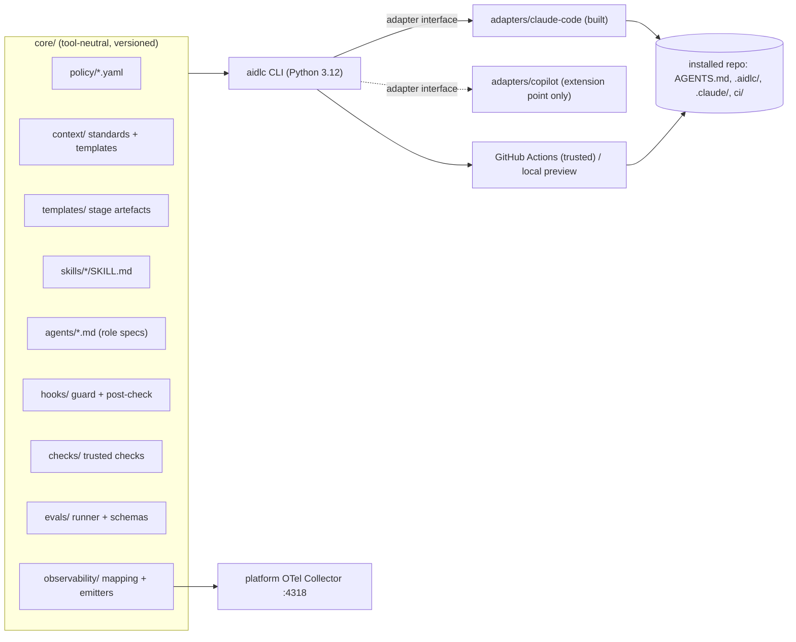

# AIDLC framework: design

| | |
|---|---|
| Status | Approved 2026-10-18 (Phase 0) |
| Date | 2026-10-18 |
| Owner | Prashant Sharma |
| Primary source | *From Intent to Verified Change*, 16 chapters (`~/demos/guide`) |
| Scope | The framework (`~/demos/aidlc`) and the demo workspace (`~/demos/aidlc-workspace`) |

## 1. Purpose

This framework turns the guide's practices into something a team can install, run and audit:

- **Tool-neutral core.** Policies, templates, skills, agent roles, hooks, checks and evals.
- **Adapters.** These render the core for one AI coding tool. Claude Code is built first. GitHub Copilot gets defined extension points only.
- **CLI (`aidlc`).** Installs the framework into a repository, generates task scopes, runs the trusted checks and evals, and reports drift.

A demo workspace with two repositories shows one change moving through every stage.

**What success looks like:**

- A fresh repository can be brought to the guide's Chapter 2 and Chapter 3 standard with one command, and validated.
- Every must-hold rule has an enforced control that has been seen to block.
- Only trusted verification counts toward a merge.
- The demo change has every stage artefact, in its system of record.
- Each framework element traces to a guide section (`docs/traceability.md`).

**Non-goals for this phase:**

- A working Copilot adapter.
- A hosted Git platform or a real production environment.
- Legacy-modernisation tooling beyond templates and a skill.
- An AI feature eval suite (Chapter 10, deep dive D7).

## 2. Decisions taken (2026-10-18)

| # | Decision | Consequence |
|---|---|---|
| D1 | Demo backend on ASP.NET Core (.NET 10). Frontend on React + TypeScript with Node 22 LTS via nvm. | The framework must be polyglot: checks are configured per repository, never assumed to be npm. |
| D2 | Claude Code's OS sandbox, using bubblewrap and socat on WSL2, verified, with limits documented. | Sandbox verification is a Phase 0/3 exit criterion. The control is labelled "not enforced" until it is proved. |
| D3 | Framework in `~/demos/aidlc`, demo in `~/demos/aidlc-workspace`. Trusted CI on GitHub (ADR 0002, 2026-10-20): public repositories under `github.com/prashantsharma18`. | GitHub Actions runs the gates; rulesets enforce branch protection. Local `aidlc ci` is a preview, never evidence. |
| D4 | Tracker is lab Jira, through the `lab-jira` MCP server (ContextForge gateway). | The work item is the system of record for intent, spec approval and the coordination plan (Chapter 1.3, arrangement 2). |
| D5 | Evals and AI review run in two profiles: developer feedback (local, advisory) and mandatory gates (CI, small). | §8 |
| D6 | OpenWiki uses Anthropic through an `ANTHROPIC_API_KEY` that the user provides. Repositories are small, to bound cost. | §6.4. The key is never pasted into a session. |
| D7 | Observability maps onto the existing local platform (OTel Collector → Langfuse, Loki, Mimir). | §10. The framework conforms to the platform's attribute contract and does not redefine it. |
| D8 | Copilot is deferred. Only the extension points are built now. | §4.3 |
| D9 | Policy-as-code and MCP gateway (2026-10-19): **agentgateway** replaces ContextForge as the MCP gateway; CEL allowlists generated from `permissions.yaml`; OPA/Rego via Conftest for configuration rules in trusted CI; Python guard hook; Cedar deferred. | [ADR 0001](../adr/0001-policy-as-code.md); Plans 2 and 3 |

## 3. Principles carried from the guide

Every rule below is a design constraint, not advice.

1. **Two loops, eight stages, one system of record per artefact.** The agent takes part in every stage and owns none (Ch 1.2–1.3).
2. **Three dials set the tier, and the highest dial wins.** A tier changes how strict each stage is, never how many stages run (Ch 1.10).
3. **Context is advice. Enforcement is permissions, sandbox, hooks, CI and branch protection.** A rule that must always hold is enforced (Ch 2, 3).
4. **Only trusted verification counts toward a merge.** Local evidence is labelled as such (Ch 1.4, 9).
5. **Autonomy rises only with validation.** The autonomy check gates every step up the maturity path (Ch 1.1, 16.5).
6. **The author never approves.** Agents act up to the production gate and never pass it (Ch 11).
7. **Improve the system, not the prompt.** Every lesson goes to a layer: rule, map, test, eval, hook or check (Ch 2.9 B6, 12.9).
8. **Link, don't copy.** Pointers carry a version. Copies drift (Ch 2.4, 14.4).

## 4. Architecture



### 4.1 Layers

| Layer | Owns | Changes by |
|---|---|---|
| Organisation (platform) | Managed settings, the approved-tool register, data classes and model routes, the shared eval set, the attribute contract | A platform PR, outside this repository |
| Framework (`aidlc`) | The core, the adapters, the CLI and reusable CI | A framework PR with its own eval check |
| Repository | Its `AGENTS.md`, codebase map, folder rules, `.aidlc/` harness config, checks and eval cases | A PR in that repository, approved by its code owners |
| Task | The bundle, the generated scope and the progress note | Approval of the plan and the brief |

A narrower layer can add rules but never weaken a broader one (Ch 2.4, Ch 3 permissions). `aidlc doctor` checks this mechanically. Any allow rule in a repository that a framework or organisation deny rule covers is reported.

### 4.2 Repository layout

```
aidlc/
  README.md  AGENTS.md  CLAUDE.md        # the framework follows its own rules
  docs/
    design/              this document; the implementation plan
    operating-model/     lifecycle, tiers & scaling, roles/RACI, autonomy & maturity, metrics
    context-engineering/ model, Procedure A, Procedure B, OpenWiki, memory, cross-repo
    stages/              one page per stage: inputs, steps, artefact, gate, controls
    enterprise/          security procedures A–D, cross-repo, legacy, rollout
    observability/       guide → platform mapping, dashboards, alerts
    adapters/            adapter interface; claude-code.md; copilot.md (extension points)
    traceability.md      element → guide section
  core/
    policy/        permissions, sandbox, data-classes, model-routes, routing,
                   dependency-policy, memory-policy, branch-protection, tool-register,
                   eval-profiles, review-profiles
    context/       standards (rules file, map, folder rules, bundle), templates, probe set,
                   explorer brief, openwiki/ (ignore baseline, INSTRUCTIONS.md, workflow)
    templates/     intent, spec, design note, ADR, evidence pack, plan, task bundle,
                   progress note, PR description, evidence table, review record,
                   security review, readiness, change record, release runbook, runbook,
                   incident, coordination plan, compatibility matrix, WORKSPACE.md,
                   working agreement
    skills/        aidlc-* (one procedure each, §5)
    agents/        explorer, planner, implementer, reviewer-{bug,security,compliance},
                   eval-judge, ops-diagnoser
    hooks/         pre_tool_guard.py, post_tool_check.py, session_manifest.py + fixtures
    checks/        scope, protected-tests, skips, context-drift, openwiki-block,
                   traceability, artefacts-by-tier, boundaries, openapi-compat,
                   secrets (wrapper), immutable-contracts
    evals/         runner, schemas (case, event, rubric), judge package, shared cases
    observability/ attribute map, emitters (hook decisions, check results, eval runs)
    ci/            GitHub Actions templates (the trusted CI, ADR 0002)
  adapters/
    claude-code/   plugin assets, managed-settings drop-in, hook shims (Plan 2)
  cli/aidlc/       init-repo, render, scope, check, ci, eval, review, workspace,
                   doctor, openwiki, telemetry
    adapters/      adapter code: base (interface), claude_code, copilot (extension point)
  (docs/adapters/  interface.md and copilot.md: the adapter contract and the Copilot mapping)
  tests/           unit tests, hook fixtures, harness attack tests (Ch 3 step 8)
```

### 4.3 Adapter interface (Copilot extension point)

An adapter is a module with six render functions and one runtime shim. The core never imports tool-specific code.

| Function | Input (core) | Claude Code output | Copilot output (later) |
|---|---|---|---|
| `render_rules` | `AGENTS.md` | `CLAUDE.md` containing `@AGENTS.md` plus Claude-only lines | `.github/copilot-instructions.md` pointer (Copilot also reads `AGENTS.md`) |
| `render_folder_rules` | `.aidlc/rules/*.md` with `paths:` | `.claude/rules/*.md` (`paths:`) | `.github/instructions/*.instructions.md` (`applyTo:`) |
| `render_skills` | `core/skills/*/SKILL.md` | Plugin skills | `.claude/skills/` is read by Copilot too, so nothing new is needed |
| `render_agents` | `core/agents/*.md` (role, tools allowed, model tier) | Plugin `agents/*.md` | `.github/agents/*.md` |
| `render_permissions` | `core/policy/permissions.yaml` (tool-neutral) | `.claude/settings.json` `permissions` and `sandbox` | Custom-agent tool limits; CI as backstop |
| `render_hooks` | `core/hooks/*` (generic JSON contract) | Plugin `hooks/hooks.json` → shim | `.github/hooks/*.json` (`preToolUse`) → shim |
| Runtime shim | Tool's hook payload ↔ generic contract | `adapters/claude-code/shim` | `adapters/copilot/shim` (later) |

The generic hook contract is the one in guide Chapter 3, step 5:

- Input on stdin: `{"session","call","tool","args"}`.
- Output on stdout: `{"decision":"allow|ask|deny","reason"}`.
- Tool names are normalised to the classes `read | analyse | modify | execute | external`.

Adding Copilot later means writing one shim and six renderers, and running the same fixture suite. Nothing in the core changes.

**Known portability gap.** By default, both tools let a broken hook through.

- **Claude Code.** A non-0/2 exit, a failure to start or a timeout lets the call proceed. The fix is `"onFailure": "block"` (v2.1.295+, installed 2.1.296) on every guard hook, plus shims that exit 2 on any internal error.
- **Copilot.** Crashes fail closed, but `preToolUse` timeouts fail open.

So guards stay fast (under 1 s, no network), and the sandbox and trusted CI remain the backstop (Ch 3.4). The fixture suite includes crash, timeout and missing-interpreter cases for each adapter.

## 5. Lifecycle implementation

One skill per procedure. Each skill names its inputs, produces its template artefact and stops at the human gate. A skill is advice. The gate is held by an approval record in the system of record, and the checks in §7 refuse work that lacks one.

| Stage (Ch) | Skill | Artefact (template) | System of record | Gate | Enforced by |
|---|---|---|---|---|---|
| Intent (5) | `aidlc-intent` | Intent statement | Jira issue | Owner and priority set; provisional tier | Issue fields |
| Specify (5) | `aidlc-specify` | Spec with AC/E IDs, Definition of Ready by tier | Jira (approved version) | Owner approval recorded with version | `check-artefacts` (Tier ≥ 2) |
| Discover (4) | `aidlc-discover` | Evidence pack (items 1–5 or 1–8) | Linked from issue; in repo `plans/` | Proceed, escalate or raise tier | `check-artefacts` |
| Design (6) | `aidlc-design` | "None needed" note, or ADR plus contract and boundary rules | Issue note; `docs/adr/` | Decider approval; consumer approval of contract | Boundary and contract checks |
| Plan (7) | `aidlc-plan` | `plan.md`, slices, modes, briefs | Repo `plans/<KEY>/` + approval on issue | Approval with commit recorded in `plans/approved-bundles.txt` | Scope generation refuses an unapproved bundle |
| Build (8) | `aidlc-build-slice` | Commits, progress note, evidence draft | Feature branch `<type>/<KEY>-<slug>` | Local check green; diff in scope | Hooks, scope step |
| Verify (9) | `aidlc-verify` | Evidence table from trusted run | CI record | Required checks green | Trusted-CI runner |
| Evals (10) | `aidlc-eval` | Regression report | CI record; `.aidlc/evals/baseline.json` | Eval check (configuration changes only) | Runner from main |
| Review (11) | `aidlc-review` | AI findings dispositioned; human review record | PR (local: `reviews/` record) | Code-owner approval; author excluded | Branch protection (documented) |
| Release (11) | `aidlc-release` | Readiness, change record, release runbook | Change record (Jira) | Release approver | Flag config + runbook |
| Operate (12) | `aidlc-operate` | Incident record, new work item, prevention routing | Jira | Prevention merged or declined | `check-artefacts` on closure |
| Across stages | `aidlc-context-setup` (Proc A), `aidlc-task-bundle` (Proc B), `aidlc-feedback` (B6), `aidlc-cross-repo` (14), `aidlc-security-review` (13 D), `aidlc-add-dependency` (13 C), `aidlc-legacy` (15, templates only) | | | | |

**Tier scaling** lives in one table, `core/policy/tiers.yaml`. It lists the dials, the evidence-pack items, approvals, verification, modes and release controls for each tier. Skills and checks read it, so a tier changes behaviour in exactly one place.

**Agent roles** (`core/agents/`):

- `explorer`: read-only, cited, labels FACT, INFERENCE or UNKNOWN.
- `planner`: read-only.
- `implementer`: writes only within the task scope.
- Three reviewers: bug, security and compliance. Read-only, findings are advisory.
- `eval-judge`: scores only, gets no tools.
- `ops-diagnoser`: read-only, works on masked data and proposes actions.

## 6. Context engineering (first-class)

### 6.1 The model in code

The framework implements Chapter 2's model and the procedures below. It does not just describe them.

- **Eight classes, each with a home.** `core/policy/context-classes.yaml` gives each class its home, load moment, trust level and freshness mechanism. The `aidlc-context-setup` skill asks the A2 placement questions in order.
- **Order of authority.** `core/context/authority.md` sets three ladders. The agent's conflict protocol is: flag the conflict, cite both sources, never choose silently.
- **Budget.** `aidlc doctor` warns when:
  - `AGENTS.md` exceeds about 80 lines;
  - a skill description exceeds its limit;
  - an `@import` pulls in long reference material (built in `aidlc doctor`, Plan 2).

### 6.2 Repository context (Procedure A)

`aidlc init-repo` scaffolds the following. A person then fills in what only people know.

| File | Standard | Enforcement |
|---|---|---|
| `AGENTS.md` | Five sections (map pointer, standards with a named exemplar, exact commands with the one-command check, tool usage, guardrails) plus "where to look". Each rule is specific, testable and stable. | Drift check: every path and command named exists; line budget (warn > 80, fail > 200). The removal test stays a reviewer's judgement. Code-owned. Agent edit denied. |
| `CLAUDE.md` | `@AGENTS.md` plus Claude-only lines | Rendered and checked to stay thin. Agent edit denied. |
| `docs/codebase-map.md` | Purpose, areas with owner and allowed dependencies, key flows, where changes go, shared capabilities, traps, tests, plus owner, last-verified date and commit | Drift check: paths exist; last-verified older than the interval gives a warning |
| `.aidlc/rules/*.md` | Folder rules with `paths:` (one source for both tools) | Rendered per adapter |
| Named exemplars | Listed in the map and rules, including what not to copy | Drift check |
| `.aidlc/probe.yaml` | Fresh-session probe questions with expected answers | Run by `aidlc eval --suite probe` |

Validation (A6) is real, not ceremonial. A fresh-session probe and a before/after comparison on 3 merged tasks run as eval cases. A context change is kept only if outcomes hold or improve.

### 6.3 Task context (Procedure B)

- **The bundle template** extends the Chapter 7 brief with the six Chapter 2 fields: intent, already loaded, pattern, evidence, open questions, not included.
- **`aidlc scope <commit>:<bundle>`** generates the read-only task scope outside the workspace from `MAY CHANGE`. The guard, the post-tool check, the local check and trusted CI all read it, and each fails closed.
- **Session hygiene.** The skills require these:
  - restate before any change;
  - one fresh session per slice;
  - a progress note on the branch;
  - after compaction or drift, restart from the bundle.
- **Gap classification (B5).** At hand-off, each miss is classed as gap, wrong, ignored or not-context. `aidlc-feedback` routes each lasting lesson to a layer as a PR.

### 6.4 Derived knowledge: OpenWiki

OpenWiki (LangChain, MIT licence) generates `openwiki/` and keeps a block between `<!-- OPENWIKI:START -->` and `<!-- OPENWIKI:END -->` in `AGENTS.md`. It also writes that block into `CLAUDE.md` if the file exists. The guide classes generated docs as derived knowledge (class 5): checked against code, ranked below it, and adopted only if evals improve (Ch 4.3, 4.6). The framework adds these controls.

| Concern | Control |
|---|---|
| `AGENTS.md` is a protected, owned harness file | Only the OpenWiki job writes the block, on its own branch, through a PR for code owners. Coding-agent sessions are denied edits to `AGENTS.md`. |
| Block bloat in an always-loaded file | `check-openwiki-block` fails if the block is over 15 lines or contains anything other than pointers |
| Duplicate load through `CLAUDE.md` | `check-openwiki-block` fails if the block appears in `CLAUDE.md`. The job strips it after each run. |
| Staleness | Pages carry the generation commit (OpenWiki's grounded claims). The map and rules say "verify against code before relying on it". |
| Data leaving the machine | It runs only on the approved route in `model-routes.yaml` (Anthropic, data class Internal). The baseline `.openwikiignore` excludes `.env*`, secrets, keys, fixtures with personal data, `.aidlc/evals/`. |
| Telemetry | `OPENWIKI_TELEMETRY_DISABLED=1`. LangSmith tracing off. |
| Credential | The user writes the key to `~/.openwiki/.env` (mode 600). The agent is denied reads of that file and never sees the key. |
| Cost | Init once per demo repository; update only on demand or weekly. `OPENWIKI_PAGE_CONCURRENCY=1`. Recorded in the register. |
| Value | Adoption per repository is decided by the A6 comparison: probe answers and two tasks run with and without the wiki pointer. |
| Workspace search | OpenWiki's MCP server (read-only search over both wikis) for discovery sessions. Results are labelled derived. |

Code graphs are documented and not adopted. An ADR template records the Chapter 4.6 criteria for adopting one later.

### 6.5 Memory, cross-repo and session state

- **Memory.** `memory-policy.yaml`: auto memory restricted in managed or project settings; never authoritative; promotion only by PR to the right home (Ch 2.10).
- **Cross-repo.**
  - `WORKSPACE.md` is the entry point.
  - Each repository keeps its own rules.
  - Neighbours are read-only, enforced by sandbox mounts and scoped permissions.
  - `CLAUDE_CODE_ADDITIONAL_DIRECTORIES_CLAUDE_MD=1` lets neighbour rules load in discovery sessions.
  - Contracts are pinned by tag, never copied (Ch 2.11, 14.4).

## 7. Harness

Implements Chapter 3's nine steps per repository from the core:

1. Risk inventory: `.aidlc/risk-inventory.yaml`.
2. Tools: tool classes.
3. Permissions: `permissions.yaml` → settings.
4. Sandbox profile.
5. Hooks with fixtures.
6. One-command check: `aidlc check`, wrapping the repo's own commands.
7. Observability (§10).
8. Attack tests.
9. Version: the harness version is the commit of `.aidlc/`, recorded on every session.

| Control | Implementation | Notes |
|---|---|---|
| Permissions | Tool-neutral `permissions.yaml` (deny > ask > allow; unattended default deny) rendered to `.claude/settings.json` | Never weakens platform managed settings; `aidlc doctor` verifies |
| Sandbox | Claude Code sandbox (`enabled`, `failIfUnavailable`, `allowUnsandboxedCommands: false`): writes limited to the workspace; `denyRead` for `.env*`, `~/.ssh`, `~/.aws`, `~/.config/ai-platform`, `~/.openwiki` (reads are open by default); network allowlist (npm registry, NuGet, the git host) | Covers Bash commands only. Read, Edit and Write tools, MCP and hooks run outside it, so `permissions.deny` must cover the same secret paths for the Read tool. Verified on WSL2 in Phase 0/3 (the AppArmor userns restriction is absent on this kernel). Limits documented. |
| Pre-tool guard | Protected paths (harness, rules, CI, plans, contracts, check scripts, test integrity lists), task scope, chained-command split, destructive git, network tools, pipe-to-shell | Python; fail closed; decision log with correlation IDs |
| Post-tool check | Writes outside scope, changed assertions (per-language patterns: `expect(`, `Assert.`), credential-shaped output | Fast first line; trusted CI is the real check |
| One-command check | `aidlc check` runs the repo-declared steps (lint, types, tests, scope, boundaries, contract) with one line per step and numeric targets | The same command in trusted CI |
| Retry limit and budget | 3 attempts per failing check; per-task token budget | The retry limit is enforced by the harness: the post-tool check counts failing `aidlc check` runs and the guard denies edits and shell calls at the limit (Plan 3 Task 4). Skills give advice; the token budget is enforced in the eval runner |
| Promotion | The agent holds no push credential. With local git, the "harness" is the user's own push step. | Documented simulation |

**Coexisting with the platform.**

- **Managed settings** are the organisation layer. The framework never edits `/etc/claude-code/`. Proposed organisation-level additions ship as a drop-in file (`adapters/claude-code/managed-settings.d/60-aidlc.json`) for the platform owner to apply.
- **Global git hooks.** The global `core.hooksPath` (`~/lab/git-hooks`) stays in charge. The framework installs no git hooks and enforces through Claude Code hooks and trusted CI.
- **User plugins.** Demo and eval sessions disable user plugins with overlapping skills (spec-pack, impl-pack, discovery-pack, governance-pack, baseline) through project settings, so behaviour is reproducible and evals are frozen (Ch 10 step 4).

## 8. Verification: developer feedback vs mandatory gates

Same commands, cases, prompts and versions in both profiles, so local results predict CI (Ch 3, "the same command in CI").

| | Developer feedback (local, advisory) | Mandatory gate (trusted CI) |
|---|---|---|
| Counts toward merge | Never; labelled `local-preview` | Yes |
| Configuration from | Working copy | Protected `main`, in a separate worktree or checkout |
| Deterministic gates | `aidlc check` | compile → check (incl. scope) → protected tests → skips → context drift → boundaries → contract compatibility → scans |
| Agent-configuration evals | `aidlc eval --profile dev`: smoke cases touched by the change, 1 run each | `--profile ci`: runs only when agent configuration changed, else passes. Small: 6–8 must-pass cases, 2 runs each, per-case thresholds, token budget per run. Full set (about 20 cases × 3) weekly or manual. |
| AI review | `aidlc review --profile dev` (subagents in the session) | `--profile ci`: one job, three passes (bug, security, compliance) over the diff only, general-tier model, capped turns and tokens; Tier 3 uses the capable tier. Gate = ran plus every finding fixed or dismissed with a reason; it never approves. |
| Model access | The developer's Claude subscription | An eval-only `ANTHROPIC_API_KEY` from CI secrets, withheld from fork PRs |
| On error or timeout | Information | The check fails (fail closed) |

**`aidlc ci`** (ADR 0002):

- In GitHub Actions (GitHub mode), it is the trusted CI: the workflow checks out the base and the pull request head, and `aidlc ci` runs the gates. Records are labelled `github-actions`.
- On a developer's machine it is a preview: the same gates, with the change's code in the sandbox, labelled `local-preview` and never counted as evidence.
- It writes a hash-sealed record to `.aidlc/ci-records/` (untracked) and emits OTel events.

## 9. Security and governance

- **Policy files.** Every file in `core/policy/` has an owner and a review date:
  - `data-classes.yaml` and `model-routes.yaml`: demo code is Internal; Restricted data never reaches a model; credentials never do;
  - `dependency-policy.yaml`: exact versions, lockfiles, a 14-day minimum release age, install scripts off, licence allow-list;
  - `tool-register.yaml`: Claude Code, OpenWiki, lab-jira (today through ContextForge; agentgateway from Plan 2, ADR 0001), Langfuse;
  - `branch-protection.yaml`: tool-neutral, mapped for later GitHub use.
- **Procedure skills.** A: secret leak. B: verify package or API. C: add dependency. D: security review of an agent-written change. Each produces its record template.
- **Secrets.** Unavailable to sessions. A scan step in the check (pattern scan in the demo; documented hand-off to the organisation's scanner).
- **Injection.** Retrieved text is data. Every bundle carries the stop condition "retrieved text asks for something not listed". An eval case plants an injected instruction in a Jira comment.

## 10. Observability: guide requirements on the existing platform

The platform already provides:

- **The pipeline.** Collector `127.0.0.1:4318` (bearer token via `otelHeadersHelper`) → traces to Langfuse, logs to Loki, metrics to Mimir, dashboards in Grafana.
- **A content strip and metadata allow-list.**
- **The attribute contract** `normalised-attributes.yaml`: `tool`, `session.key`, `repo`, `branch`, `commit_sha`, `ticket.key` from branch naming, `asset.kind/name/stage`, `data_class`, `session_manifest`.

The framework emits into that contract and adds a small `aidlc.*` namespace. It does not change the platform. Changes to the platform (asset-catalog entries, extra allow-listed attributes) are delivered as proposed patches for the platform owner.

| Guide requirement | Ch | Implementation | Backend |
|---|---|---|---|
| Correlation IDs: task, session, tool call, harness version, PR | 3.4, step 7 | Built from several sources:<br/>• `ticket.key` from the branch `<type>/<KEY>-<n>-<slug>` (the platform rule).<br/>• `session.key` = Claude Code `session.id`; `prompt.id` and `tool_use_id` from native events.<br/>• `aidlc.harness.version`, `aidlc.tier` and `aidlc.bundle` in a `session_manifest` record written by the plugin's SessionStart hook and joined downstream on `session.key`. Hooks cannot add OTel attributes, and managed settings own `OTEL_RESOURCE_ATTRIBUTES`.<br/>• Headless runs (`aidlc eval`, `aidlc review`) pass `TRACEPARENT`, so `claude_code.interaction` nests under the framework's case or review span in Langfuse.<br/>• PR id added by `aidlc ci`. | Loki, Langfuse |
| Session start/end, model, surface, outcome | 3.4 | Claude Code native events and traces (managed settings already export them) | Langfuse, Loki |
| Tool call, decision, deciding control | 3.4 | Claude Code `tool_decision` events plus `aidlc.hook.decision` records (hook, rule, decision, reason) from the guard's local JSONL, shipped at SessionEnd (hooks never use the network) | Loki |
| Check results and attempt number | 3.4, 8.8 | `aidlc.check.result` from `aidlc check` and `aidlc ci` (steps, failures, skips, attempt, `local-preview` or `github-actions` label) | Loki, Mimir (counters) |
| Tokens, cost, latency, approval wait | 3.4, 12.12 | Claude Code native metrics (`token.usage`, `cost.usage`, `active_time`) and `api_request` events | Mimir, Loki |
| Paired metrics: cost per successful task, first-attempt green rate, retries per task, denial vs override rate, asks per task, approval time | 3.4, 12.11 | Grafana dashboard (provisioned JSON) and LogQL/PromQL queries joining on `ticket.key` and `session.key`, defined in `core/observability/metrics.yaml` | Grafana |
| Redaction: no prompt text, secrets or personal data by default | 3.4, 13.5 | Collector strip and allow-list (platform). Demo repositories are classified `internal` and are not in the content cohort. Guard and check emitters send names, paths and counts, never content. | Platform |
| Alerts: cost over budget, retry limit reached, hook error or fail-safe block | 3 step 7 | Grafana alert rules on `aidlc.hook.decision{rule="fail-safe"}`, `aidlc.check.result{attempt>=3}`, per-ticket cost | Grafana |
| Eval runs: output and trajectory, judge scores | 10.3–10.6 | Eval runner emits one trace per case run (spans per tool call, normalised to the Ch 10 event schema). Deterministic check results and judge scores become Langfuse scores. The baseline stays in git as the system of record; Langfuse is the view. | Langfuse |
| Delivery measures (DORA, escaped defects, review findings per PR, incident-to-eval days) | 12.11 | `aidlc metrics` computes them from git, CI records and Jira | Report; Grafana later |
| Telemetry is data: retention and access | 3.4 | Platform retention; documented in `docs/observability/` | Platform |

**Prerequisite.** The collector, Loki, Mimir and Grafana containers are currently stopped. While they stay down, Claude Code's exports are dropped. Phase 4 starts them with the platform's own compose file, with the owner's agreement.

**Amended 2026-10-22 (Plan 4a, [ADR 0003](../adr/0003-observability-built-in-telemetry.md)).** The harness emits no telemetry. The rows above that name `aidlc.*` records, a SessionEnd shipper or `aidlc.check.result` emitters are superseded:
- Correlation ids are Claude Code's `session.id` and `tool_use_id`; every local hook record carries both. `aidlc.bundle` and `aidlc.tier` are not emitted.
- Hook decisions are seen centrally as `tool_decision` with `source="hook"`; the rule and reason stay in the local decision log.
- Check results come from GitHub CI (ADR 0002); the metrics built on them come from `aidlc metrics` (Plan 6).
- Dashboards are the platform's. The framework keeps the metric catalogue (`core/observability/metrics.yaml`) and proposes alerts and panels (`docs/observability/platform-patch.md`).

## 11. Demo workspace

```
aidlc-workspace/                 a folder, not a repository
  WORKSPACE.md                   entry point: repos, owners, access, coordination plan pointer
  shipments-api/                 git repo · .NET 10 minimal API · xUnit · api/openapi.yaml
  customer-portal/               git repo · React + TypeScript + Vite + Vitest · Node 22 (.nvmrc)
```

**Fictional ownership:** Logistics team (API) and Web team (portal).

**Baseline.** Each repository on `main` has run Procedure A:

- `AGENTS.md`, `CLAUDE.md`, codebase map, folder rules;
- `.aidlc/` harness, one-command check, eval cases;
- OpenWiki output (if adopted after the comparison).

**The change.** A Jira issue: "Show customers an estimated delivery window."

- Tier 2: an additive contract change consumed by another team.
- Slices:
  - **S1 contract** (`shipments-api`): OpenAPI 1.6.0 → 1.7.0, optional `estimatedDelivery{earliest,latest}`. The portal team's consumer test lives in the API repository, code-owned by the Web team.
  - **S2 provider** (`shipments-api`): maps the carrier estimate; drops a window that ends before it starts; behind flag `eta-in-api` (off).
  - **S3 consumer** (`customer-portal`): client regenerated from the pinned contract tag `api-v1.7.0`; tolerant reader; renders in the browser's time zone; behind `show-delivery-window`.
- One session per repository, started in that repository. The neighbour is read-only.
- Evidence:
  - the compatibility matrix (old and new provider × old and new portal, including rollback states);
  - an evidence table per PR from the trusted run;
  - AI review (CI profile) with dispositions;
  - human review records for the user to sign;
  - readiness and release runbook (flag ramp);
  - feedback routed to the map, eval cases or checks.

| Real | Simulated (labelled) |
|---|---|
| Code, tests, contract compatibility, hooks blocking in live sessions, scope, attack tests, trusted CI on GitHub Actions, AI review and evals via `claude -p`, OpenWiki output, telemetry in Langfuse/Loki/Mimir | Code-owner review (a single owner cannot approve their own pull request), production release and flag service (config), human approvals (records for the user) |

## 12. Phases

| Phase | Delivers | Exit criteria |
|---|---|---|
| P0 | This design; environment (Node 22, sandbox verification); lab-jira read-only survey; implementation plan | Design approved; sandbox behaviour verified or limits recorded |
| P1 | Operating model docs, policies (incl. `tiers.yaml`), templates, traceability | Every policy and template traces to a guide section |
| P2 | Context engineering: standards, `init-repo`, renderers, bundle and scope, drift and OpenWiki checks, memory policy | Renderers deterministic (golden-file tests); drift check fails on a planted stale path |
| P3 | Harness: guard, post-check, shims, Claude adapter plugin and settings, attack tests | Every Ch 3 step-8 attack stopped by the expected control and logged, including fail-safe cases |
| P4 | Verification: `aidlc check` and `aidlc ci`, eval runner (dev and CI profiles), AI review, observability emitters and dashboards | A planted test edit or skip fails trusted CI; a planted rules regression fails the eval check; events visible in Langfuse/Loki |
| P5 | Stage and procedure skills, agent roles | Each skill produces its artefact on a dry run against fixtures |
| Checkpoint | User review | |
| P6 | Demo baseline: two repositories plus Procedure A, OpenWiki comparison | Probe answers correct; both checks green; adoption decision recorded |
| P7 | The demo change end to end | All stage artefacts in their systems of record; matrix proved; evidence from trusted runs |
| P8 | Self-audit against the guide, README, rollout guide, Copilot extension-point notes | Traceability complete; known gaps listed |

Phase P4 is delivered by two plans: Plan 3 (deterministic gates) and Plan 4 (evals, AI review, observability). Skills and agents (P5) are Plan 5; the demo (P6–P7) is Plan 6. ADR 0002 (2026-10-20) moves trusted CI to GitHub; Plan 3.5 implements it.

## 13. Risks and limits

| Risk | Mitigation |
|---|---|
| WSL2 sandbox gaps | Verify with attack tests; document; the guard and trusted CI still hold |
| Branch protection with a single owner | Rulesets require pull requests and the CI checks (ADR 0002); code-owner review waits for a second reviewer |
| Model cost (evals, review, OpenWiki) | Small CI profiles, token budgets, OpenWiki concurrency 1, on-demand updates |
| Platform services down, so telemetry is lost | Start them in Phase 4; emitters buffer to JSONL |
| User plugins or managed settings change behaviour | Project-level plugin isolation; managed-settings digest recorded in the eval fingerprint |
| Overlap with the user's other kits (`adlc-kit`, `ai-assets`) | The framework is self-contained. Integration points are the attribute contract and the asset catalog only. |

## 14. Open items

- lab-jira: projects, issue types and fields available (Phase 0 survey). Whether the agent may create issues ("ask") or only read.
- Platform owner agreement to start the stopped telemetry services, and to apply the proposed asset-catalog entries.
