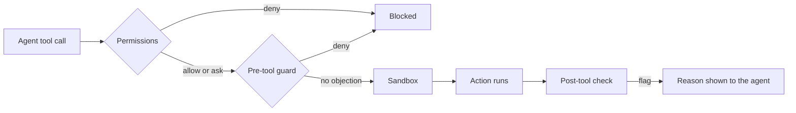

# The harness

The harness is everything that limits what an agent can do and notices when it goes wrong. It
has three layers: permissions, a sandbox and hooks. This page maps the guide's chapter 3
(steps 1–9) to the parts of the framework that implement each step.

| Step | What it is | Where it lives |
|---|---|---|
| 1 Risk inventory | What can go wrong, how bad, which control answers it | `core/policy/risk-inventory.yaml` |
| 2 Tool classes | Every tool call is `read`, `edit`, `shell`, `mcp` or `external`; any other class (the shim's `unknown`) is denied with rule `unknown-tool` | `core/hooks/claude_shim.py` (`CLASSES`), [adapter interface](../adapters/interface.md) |
| 3 Effective permissions | Baseline policy narrowed by the repository | `core/policy/permissions.yaml`, `cli/aidlc/harness.py` |
| 4 Sandbox | Operating-system limits on commands | `cli/aidlc/adapters/claude_code.py` |
| 5 Hooks | Pre-tool guard, post-tool check, tool shim | `core/hooks/` |
| 6 One-command check | `aidlc check` as the single verification entry point | Plan 3 |
| 7 Observability | Dashboards and alerts over the decision log | Plan 3 |
| 8 Attack tests | Prove each control stops the attempt it exists for | `tests/unit/test_attacks_direct.py`, `tests/harness_live/` |
| 9 Version | `harness.json` `version`, the manifest and code owners | `cli/aidlc/harness.py`, `cli/aidlc/adapters/base.py` |

Two items inside these steps are also not built yet:

- **Retry limits** (the `runaway-loop` risk) need the runner. They arrive in Plan 3.
- **The agent-side MCP gateway check** waits for the platform cutover (platform ADR 20,
  milestone M36). The gateway itself belongs to the platform.

## Read in this order

1. [Permissions and sandbox](permissions-and-sandbox.md): what the tool blocks before a command runs.
2. [Hooks](hooks.md): what the guard and the post-tool check decide, and how to add a rule.
3. [Doctor](doctor.md): how `aidlc doctor` proves the harness is intact in a repository.

## How the layers fit

Each layer assumes the one before it can be bypassed. That is why secret paths are denied
twice and protected paths three times. Read the reasons in [permissions and
sandbox](permissions-and-sandbox.md).

## Trust boundaries

Know what the harness trusts before you rely on it.

- **The manifest and the hooks are protected.** `.aidlc/generated.json` and `.aidlc/hooks/`
  have an `Edit` deny and a sandbox `denyWrite`. A forged manifest entry would let `aidlc render`
  overwrite a file a person wrote, because render trusts the manifest to know what it generated.
- **Hooks run outside the sandbox.** Claude Code's sandbox applies to Bash commands only; the Read tool already bypasses it ([sandbox verification](../verification/2026-10-18-sandbox-wsl2.md)). Hooks are ordinary processes with your permissions. This is
  why they are standard-library only, offline and short, and why a repository must not be able to
  edit them.
- **The decision log lives outside the repository.** Guard decisions go to `~/.aidlc/logs`, so
  an agent that can write the repository cannot rewrite its own audit trail. Task scope files live
  under `~/.aidlc` for the same reason.
- **Trusted CI is the real check.** The post-tool check cannot undo an action. It is the fast
  first line, and CI is the backstop.

Guide: 3 steps 1–9, 3.4, 3.7.
