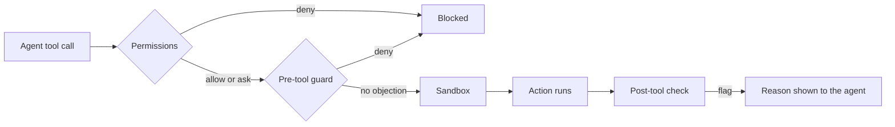

# The harness

The harness is everything that limits what an agent can do and notices when it goes wrong. It
has three layers: permissions, a sandbox and hooks. This page maps the guide's chapter 3
(steps 1–9) to the parts of the framework that implement each step.

| Step | What it is | Where it lives |
|---|---|---|
| 1 Risk inventory | What can go wrong, how bad, which control answers it | `core/policy/risk-inventory.yaml` |
| 2 Tool classes | Every tool call reaches the guard and is `read`, `edit`, `shell`, `mcp` or `external`; any other class (the shim's `unknown`) asks a person with rule `unknown-tool`, which is a deny when unattended | `core/hooks/claude_shim.py` (`CLASSES`), [adapter interface](../adapters/interface.md), [ADR 0002](../adr/0002-tool-classes.md) |
| 3 Effective permissions | Baseline policy narrowed by the repository | `core/policy/permissions.yaml`, `cli/aidlc/harness.py` |
| 4 Sandbox | Operating-system limits on commands | `cli/aidlc/adapters/claude_code.py` |
| 5 Hooks | Pre-tool guard, post-tool check, tool shim | `core/hooks/` |
| 6 One-command check | `aidlc check` as the single verification entry point; `aidlc ci` runs the same gates in trusted CI | `cli/aidlc/checks/onecheck.py`, `cli/aidlc/ci.py`, [the one-command check](../checks/README.md), [trusted CI](../checks/ci.md) |
| 7 Observability | Dashboards and alerts over the decision log | Plan 4 |
| 8 Attack tests | Prove each control stops the attempt it exists for | `tests/unit/test_attacks_direct.py`, `tests/harness_live/` |
| 9 Version | `harness.json` `version`, the manifest and code owners | `cli/aidlc/harness.py`, `cli/aidlc/adapters/base.py` |

**Retry limits** (the `runaway-loop` risk) are built into the hooks. The post-tool check counts
failing runs of `aidlc check`, and at the limit the guard denies every edit and shell call. See
[the retry limit](../checks/README.md#the-retry-limit).

One item inside these steps is not built yet. **The agent-side MCP gateway check** waits for the
platform cutover (platform ADR 20, milestone M36). The gateway itself belongs to the platform.

## First install

Install the harness in a repository in this order. Each step depends on the one before.

> ⚠️ **Watch out:** Start Claude Code at the repository root. A session started in a
> subdirectory does not load the project settings, so no permissions, sandbox or hooks apply.
> `aidlc doctor` cannot detect where a session starts
> ([check 7](../verification/2026-10-18-sandbox-wsl2.md#2026-10-19-check-7)).

1. **Commit on the base branch.** The base branch (`harness.base_branch`, default `main`) must
   exist with at least one commit. Approvals are read from it, and the post-check diffs against
   it. A fresh `git init` has no branch until the first commit.
2. **Run `aidlc init-repo`.** It writes `.aidlc/config.yaml`, `AGENTS.md`, the narrowing file and
   `plans/approved-bundles.txt`. Set `harness.base_branch` now if your base is not `main`.
3. **Run `aidlc render --tool claude-code` and commit the result on the base branch.** Literal
   sandbox `denyWrite` entries are rendered only for paths that exist, so render again after you
   add a protected file such as `.github/` or `api/`.
4. **Approve a bundle, then run `aidlc scope --branch <task branch>`.** A person appends the
   approval line to `plans/approved-bundles.txt` on the base branch. `aidlc scope` writes the
   read-only scope, with the base commit it trusts, to `~/.aidlc/scopes/`. Without a scope every
   edit is denied (`no-scope`). This also creates `~/.aidlc`, which the sandbox denies for
   writes; create it before the first session so the sandbox does not put a placeholder there.
5. **Run `aidlc doctor`.** Fix every FAIL before the first session. D12 fails when the base
   branch does not exist.

After you update a task branch from the base (rebase or merge), run `aidlc scope` again. The
scope trusts the base commit recorded when it was approved, so the base's newer commits look
like changes on the task branch until you re-scope. The post-check says so in its flag message.

## Read in this order

1. [Permissions and sandbox](permissions-and-sandbox.md): what the tool blocks before a command runs.
2. [Hooks](hooks.md): what the guard and the post-tool check decide, and how to add a rule.
3. [Doctor](doctor.md): how `aidlc doctor` proves the harness is intact in a repository.
4. [The one-command check](../checks/README.md), [trusted CI](../checks/ci.md) and
   [policy as code](../checks/policy-as-code.md): the gates the change must pass.

## How the layers fit

Each layer assumes the one before it can be bypassed. That is why secret paths are denied
twice. An existing protected file is covered three times: the `Edit` deny rule, the guard and the
sandbox. A new protected file is covered by the `Edit` deny rule and the guard for the Edit tools,
and detected by the post-check for the shell. Read the reasons in [permissions and
sandbox](permissions-and-sandbox.md).

## Trust boundaries

Know what the harness trusts before you rely on it.

- **The manifest and the hooks are protected.** `.aidlc/generated.json` and `.aidlc/hooks/`
  have an `Edit` deny and a sandbox `denyWrite`. A forged manifest entry would let `aidlc render`
  overwrite a file a person wrote, because render trusts the manifest to know what it generated.
- **Hooks run outside the sandbox.** Claude Code's sandbox applies to Bash commands only; the Read tool already bypasses it ([sandbox verification](../verification/2026-10-18-sandbox-wsl2.md)). Hooks are ordinary processes with your permissions. This is
  why they are standard-library only, offline and short, and why a repository must not be able to
  edit them.
- **The decision log lives outside the repository.** Guard decisions go to `~/.aidlc/logs`, so
  an agent that can write the repository cannot rewrite its own audit trail. Task scope files live
  under `~/.aidlc` for the same reason.
- **A local base branch is a simulated trust root.** Approvals and the post-check trust the
  base branch. `aidlc scope` records its commit in the scope file, and the guard denies the git
  commands that move it. The guard cannot see a raw shell write to `.git/refs/heads/<base>`,
  though, at any time. So [trusted CI](../checks/ci.md) never trusts the live ref on its own:
  local `aidlc ci` judges against the commit pinned in the scope file, and refuses to run when
  the live ref no longer matches it. The refusal alone does not undo a forgery: the forged commit
  is the base now. So re-scoping after the base moved is a confirmation step. `aidlc scope` lists
  every commit since the pinned base, marks with `!` those that touch approvals, skips,
  exceptions or configuration, and pins the new base only with
  `--accept-base <full live sha>`, which agents are denied. A person who accepts a commit they
  did not review accepts the forgery. Once a remote exists, the GitHub workflow reads approvals
  and configuration from the pull request's base commit, behind branch protection.
- **Trusted CI is the real check.** The post-tool check cannot undo an action. It is the fast
  first line, and [`aidlc ci`](../checks/ci.md) is the backstop.

Guide: 3 steps 1–9, 3.4, 3.7.
