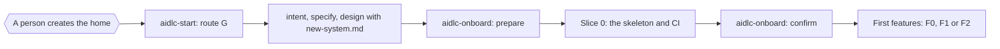
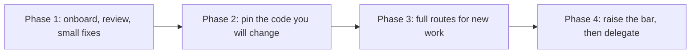

# Adopting aidlc

How a team starts with aidlc: on a new system from day 0, or on an existing one in phases. The last section is a
one-page sheet of who approves what.

## Before you start

You need four things, whatever the system:

- **A tracker** the agent can read (read-only), where approvals are recorded with each document's version.
- **CI** that runs the repository's tests on every pull request, and branch protection that requires it.
- **Code owners** for every path, and a rule that the author never approves their own change.
- **Someone who owns the rules file** (`AGENTS.md`) and keeps it true.

Then install the plugin and copy the starter files ([quickstarts](../quickstart/)). The
[autonomy check](autonomy-and-maturity.md) decides how much the agent may do on its own; it starts small.

## A new system: day 0

1. **A person creates the home.** One repository when the system is one repository. A workspace, onboarded at its
   root, when it is several or undecided. The agent never creates a repository.
2. **Run `aidlc-start`.** In an empty home it chooses route G.
3. **Decide the system.** `aidlc-intent`, `aidlc-specify` and `aidlc-design` write the story, the first criteria and
   `new-system.md`: the stack, every dependency pinned, the repository layout, the contracts, the commands and the
   scaffold. Approving it approves those dependencies and commands. These documents merge on their own.
4. **Prepare.** `aidlc-onboard` (new mode) copies the starter files and writes `AGENTS.md`, each command marked
   `(not yet run)`. A person turns on branch protection that requires a code owner.
5. **Slice 0.** `aidlc-plan`, `aidlc-build`, `aidlc-verify` and `aidlc-review` build the skeleton under the usual
   gates: the scaffold recipe, one real test, a health check and CI.
6. **Confirm.** `aidlc-onboard` runs every command, clears the marks and writes the map. A person makes slice 0's
   checks required.
7. **Build the first features** as F0, F1 or F2. From here the repository is ordinary.

## An existing system, in phases

Do not switch everything on at once. Each phase pays for itself and earns the next.

### Phase 1: onboard, and value at low risk

- Run `aidlc-onboard` once per repository: it writes `AGENTS.md`, the codebase map, the Legacy list (code with no
  tests that pin it) and today's Quality bar values under Measured. Review both files in a pull request.
- Copy the starter's `ai-review.yml` so the reviewer agents comment on every pull request, including ones the kit did
  not produce. `aidlc-review` turns the findings into a review record for kit-built changes. AI review is evidence
  for the code owner, never the approval.
- Send bugs through `aidlc-start`. Tier 1 bugs with a written expected behaviour take D1: a brief, a reproducing test,
  a fix.

Exit when `AGENTS.md` answers the onboarding probe questions and D1 fixes merge without surprises.

### Phase 2: pin the code you will change

- Before changing code on the Legacy list, record what it does today with characterisation tests (the
  `writing-tests` practice). `aidlc-build` stops on legacy code that has no such test.
- Use `aidlc-discover` where the change touches code nobody understands well: it gathers evidence read-only and
  lists the untested paths as findings.

Exit when the areas on next quarter's roadmap have their behaviour pinned.

### Phase 3: the full routes for new work

- New features take F0, F1 or F2; change requests take C; other defects take D2. `aidlc-specify` writes testable
  criteria, `aidlc-design` records the decisions (most end at "none needed"), `aidlc-plan` slices the work into
  bundles the tech lead approves, and `aidlc-release` ships with stop criteria.
- When a change spans repositories, set up a workspace (`starter/workspace/`, then `aidlc-onboard` at its root) and
  track the story there.

Exit when stories run end to end with their approvals on the tracker.

### Phase 4: raise the bar, then delegate

- Move each Quality bar dimension from Measured to Enforced once it has a check command, and ratchet it: coverage no
  lower than today, size and latency within a set margin. An exception needs a reason, an owner, an expiry date and a
  person's approval.
- When a repository passes the [autonomy check](autonomy-and-maturity.md), let the tech lead approve delegate modes in
  bundles, within the tier: delegate with checkpoints at Tiers 1 and 2, delegate at Tier 1. Run approved delegate
  slices with the starter's `scripts/run_slices.py`: one fresh session per slice, stopping at the first that does
  not finish. You review the diffs at the end and push.

Tier 3 stays hands-on at every phase.

## Who approves what

The agent drafts every document and decides nothing on this sheet. Nobody approves what they wrote: never the
author, never the author's agent, never an AI reviewer.

| Decision | Who | Where it is recorded |
|---|---|---|
| The story and its acceptance criteria | Product owner | The tracker |
| The route | Tech lead agrees what `aidlc-start` proposes | The story's index |
| The spec | Spec owner (specialists at Tier 3) | The tracker, with the spec's version |
| A changed criterion | The criterion's owner | The spec's Amendments line |
| Which parts a change affects | Tech lead | The tracker |
| Design decisions, or "none needed" | Tech lead or architect | The tracker; ADRs in `docs/adr/` |
| A contract change | Every consumer | The tracker, with the contract's version |
| A new system's stack and dependencies | Architect or tech lead | The tracker, approving `new-system.md` |
| The plan and its bundles, including each MODE | Tech lead | The tracker, with the plan's version and commit |
| A fast-path brief (`fix.md`, `brief.md`) | The engineer confirms; a code owner approves | The CONFIRMED line; the pull request |
| A recipe commit (a tool's mechanical output) | The engineer reviews it as generated code | The pull request |
| Passing a checkpoint in a delegated slice | The engineer | The progress note's "confirmed by" line |
| A new dependency | A person, asked first | The plan or the pull request |
| An exception to the Quality bar | A person, with a reason, an owner and an expiry date | Next to the code, or in `AGENTS.md`'s Quality bar |
| The merge | A code owner who did not write or push the change | The pull request |
| Required checks and branch protection | A repository administrator | The git host |
| The release | Release approver (named at Tier 3) | The change record |
| Containment of an incident | On-call; a person runs every runbook step | The incident record |
| Where each lesson goes | The owner of each source | The feedback record |

Tiers add approvers, never stages: see [roles.md](roles.md) and [tiers.md](tiers.md).
