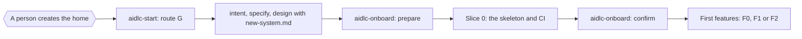
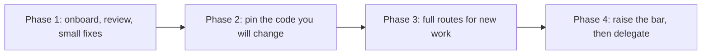

# Adopting aidlc

How a team starts with aidlc: on a new system from day 0, or on an existing one in phases. The last section is a
one-page sheet of who approves what.

## Before you start

You need four things, whatever the system:

- **A tracker**, where approvals are recorded with each document's version. The agent reads it when it is connected
  (otherwise you paste the work item) and posts only when you ask.
- **CI** that runs the repository's tests on every pull request, and a rule that a red run never merges (the code
  host's merge rules where the team has them; aidlc needs none).
- **Code owners** for every path, and a rule that the author never approves their own change.
- **Someone who owns the rules file** (`AGENTS.md`) and keeps it true.

Then install the plugin and copy the starter files ([the Claude Code quickstart](../quickstart/claude-code.md); Copilot, Codex and Cursor have
their own beside it). The
[autonomy check](autonomy-and-maturity.md) decides how much the agent may do on its own; it starts small.

## A new system: day 0

1. **A person creates the home.** One repository when the system is one repository. A workspace, onboarded at its
   root, when it is several or undecided. The agent never creates a repository.
2. **Run `aidlc-start`.** In a home with no code it asks whether this is a new system and, if so, chooses route G.
3. **Decide the system.** `aidlc-intent`, `aidlc-specify` and `aidlc-design` write the story, the first criteria and
   `new-system.md`: the stack, every dependency pinned, the repository layout, the contracts, the commands and the
   scaffold. Approving it approves those dependencies and commands. These documents merge on their own.
4. **Prepare.** `aidlc-onboard` (new mode) copies the starter files and writes `AGENTS.md`, each command marked
   `(not yet run)`. A team whose code host can require a code
   owner's review may turn that on; aidlc never needs it.
5. **Slice 0.** `aidlc-plan`, `aidlc-build`, `aidlc-verify` and `aidlc-review` build the skeleton under the usual
   gates: the scaffold recipe, one real test, a health check and CI.
6. **Confirm.** `aidlc-onboard` runs every command, clears the marks and writes the map. A person makes slice 0's
   checks required.
7. **Build the first features** as F0, F1 or F2. From here the repository is ordinary.

## An existing system, in phases

Do not switch everything on at once. Each phase pays for itself and earns the next.

### Phase 1: onboard, and value at low risk

- Run `aidlc-onboard` once per repository: it writes `AGENTS.md`, the codebase map, the Legacy list (code with no
  tests that pin it) and today's Quality bar values under Measured. Review both files in a pull request.
- For kit-built changes, `aidlc-review` runs the reviewer agents in a fresh context on the evidence file and turns
  their findings into a review record. A team may add any AI review its code host offers, so every pull request gets
  one, including ones the kit did not produce; one that calls a model API needs a key such as `ANTHROPIC_API_KEY`
  in CI, and each run is a paid call. AI review is evidence for the code owner, never the approval.
- Send bugs through `aidlc-start`. Tier 1 bugs with a written expected behaviour take D1: a brief, a reproducing test,
  a fix.

Exit when `AGENTS.md` answers the onboarding probe questions and D1 fixes merge without surprises.

### Phase 2: pin the code you will change

- Before changing code on the Legacy list, record what it does today with characterisation tests (the
  `writing-tests` practice). On legacy code with no such test, `aidlc-build`
  writes that test first, or stops.
- Use `aidlc-discover` where the change touches code nobody understands well: it gathers evidence read-only and
  lists the untested paths as findings.

Exit when the areas on next quarter's roadmap have their behaviour pinned.

### Phase 3: the full routes for new work

- New features take F0, F1 or F2; change requests take C; other defects take D2. `aidlc-specify` writes testable
  criteria, `aidlc-design` records the decisions (most end at "none needed"), `aidlc-plan` slices the work into
  bundles the tech lead approves with the design at Tier 2 and 3 (stated at Tier 1, except a plan with independent slices, which the tech lead approves), and `aidlc-release` prepares the release and its stop criteria; a person or the pipeline ships it.
- When a change spans repositories, set up a workspace (`starter/workspace/`, then `aidlc-onboard` at its root) and
  track the story there.

Exit when stories run end to end with their approvals on the tracker.

### Phase 4: raise the bar, then delegate

- Move each Quality bar dimension from Measured to Enforced once it has a check command, and ratchet it: coverage no
  lower than today, size and latency within a set margin. An exception needs a reason, an owner, an expiry date and a
  person's approval.
- When a repository passes the [autonomy check](autonomy-and-maturity.md), let the tech lead approve delegate modes in
  bundles, within the tier: delegate with checkpoints at Tiers 1 and 2, delegate at Tier 1. Run approved delegate
  slices one fresh session per slice, each started by a person, stopping at the first that does not finish. You
  review the diffs at the end and push.
- When a mistake repeats, `aidlc-feedback` turns it into a check in the team's own project (a type, a lint rule, a
  test or a CI step), proven on the real past mistake and listed in `AGENTS.md`'s rules table.

Fast-path briefs carry a MODE the engineer chooses when confirming; until this phase, choose hands-on there too.
Tier 3 stays hands-on at every phase.

## Who approves what

The agent drafts every document and decides nothing on this sheet. When the person who decides tells it, or
when it has checked the decision (a pull request approval in the review tool, the tracker), it writes the record in the
last column and says how it was confirmed; it never writes a name it was not given (ADR 0023). It checks when it
can, even after being told. When the check disagrees, it records nothing and reports the difference to the
decider. Nobody approves what they wrote: never the author, never the author's agent, never an AI reviewer.

A person decides only where the tiers file's decisions table says ([tiers-table.md](tiers-table.md), ADR 0026): the
four decisions in bold, the hands-on restatement at Tier 3, and the decisions every tier keeps. At Tier 1 that is
Ready and Merge, and Release only when users see the change. Every other stage states what it did and goes on; a
person who disagrees says so.

| Decision | Who | When | Where it is recorded |
|---|---|---|---|
| **Ready**: the story, its acceptance criteria, its tier and its route | Product owner, with the spec owner; the tier with whoever owns the risk (on F0, D1 and S, the engineer who confirms the brief); the route is shown, and the tech lead owns it | Every tier; Tier 3 adds a specialist's spec review | Tier 1: the tracker, or the brief's CONFIRMED line. Tier 2 and 3: the approval of the spec's pull request, which merges first |
| The provisional tier | Product owner, with whoever owns the risk, inside Ready | Every tier | With Ready |
| **Design + plan**, with each bundle's MODE | Tech lead or architect | Tier 2 and 3: one pull request that merges both first; at Tier 1 the AI states them, except a plan with independent slices, which the tech lead approves | The pull request approval; the AI writes the tracker entry from it, with the plan's version and commit |
| Design decisions, or "none needed" | Tech lead or architect, inside Design + plan | Tier 2 and 3; at Tier 1 the AI states "none needed" in the plan | The design note's APPROVED or RECORDED BY line; ADRs in the folder `AGENTS.md` names |
| Proceed, escalate or raise the tier after discovery | Tech lead, with the affected owners: proceed inside Design + plan; to escalate or raise the tier is Ready | When discovery runs | The evidence pack and the work item |
| **Merge** | A code owner who did not write or push the change, after a non-author PASS, who reads the decision log with spec, plan and code | Every tier; at Tier 3 the security specialist when the change touches secrets, permissions, tool calls, dependencies or prompts | The pull request |
| **Release** | Release approver (named at Tier 3); the readiness record cites the approval | Only when users see the change; always at Tier 3 | Change management |
| The hands-on restatement | The engineer | Tier 3, per slice; stated at Tier 1 and 2 | The progress note's "confirmed by" line |
| The route | Tech lead owns it; Ready shows it, and a technical person checks its facts at the first technical decision: the engineer who confirms a brief (F0, D1, S), the code owner at Merge (F1, D2 and C at Tier 1; for a plan with independent slices, first the tech lead who approves it), the tech lead or architect at Design + plan (Tier 2 and 3); on route G, the tech lead or architect who approves `new-system.md` | Every tier, without a stop of its own; after Ready, a change that touches the tier, the scope, the criteria or the controls is decided again | The story's index: the ROUTE line, with its facts (ADR 0027) |
| A standard change list | Tech lead, once, in a pull request, as any rule | Once; route S then needs only Ready and Merge, and Release only when users see the change | The Standard changes section of `AGENTS.md` |
| A changed criterion | The criterion's owner | Every tier | The spec's Amendments line |
| Which parts a change affects | Tech lead | Every tier | The story index (an `UNAFFECTED` line); re-planned parts on the tracker |
| A wireframe | Product owner | Every tier; at Tier 2 and 3 in the pull request that merges the design and the plan | The tracker |
| A contract change | Every consumer | Every tier; at Tier 2 and 3 in the pull request that merges the design | The tracker, with the contract's version |
| A new system's stack and dependencies | Architect or tech lead | With the design (route G) | The tracker, approving `new-system.md` |
| A fast-path or standard brief (`fix.md`, `brief.md`, `standard.md`) | The engineer confirms it and its tier (Ready) and chooses its MODE; a code owner approves it at Merge | Routes F0, D1 and S | The CONFIRMED line; the pull request |
| A recipe commit (a tool's mechanical output) | The engineer reviews it (a scaffold as generated code); for a recipe class listed in `AGENTS.md`, on route S, the code owner at Merge | Every tier | The progress note's "confirmed by" line; the pull request |
| Passing a checkpoint in a delegated slice | The engineer | Where the bundle's MODE puts one | The progress note's "confirmed by" line |
| A new dependency | A person, asked first | Every tier | The plan or the pull request |
| An exception to the Quality bar | A person, with a reason, an owner and an expiry date | Every tier | Next to the code, or in `AGENTS.md`'s Quality bar |
| A judgement call made while building | No one approves a row: the code owner reads the decision log inside Merge, and may bring in the row's owner as a reviewer | Every tier | The progress note's decision log, copied into the pull request description by owner (ADR 0027) |
| Each review finding | The engineer decides it; this is their review of the diff; high and medium findings block the merge | Every tier | The review record |
| A specialist review (Tier 3) | The named specialist, who can block | Tier 3 | The pull request |
| The push | The person who ran the session, who alone holds the push credential | Every tier | The code host |
| Merge rules on the code host, where the team has them (aidlc needs none) | A repository administrator | Once | The code host |
| Monitoring and rollback | The owning team confirms, with the release decision | With Release | The readiness record |
| Containment of an incident | On-call; a person runs every runbook step | Every tier | The incident record |
| The incident follow-up item | Product owner accepts it | Every tier | The tracker |
| Where each lesson goes | The owner of each source | Every tier | The feedback record |
| The rules file and the codebase map | The person decides placement; code owners merge them | Once, then by pull request | The pull request |

Tiers add approvers, never stages: see [roles.md](roles.md) and [tiers.md](tiers.md).
