# Routes

`aidlc-start` sends every piece of work down one of eight routes. It first checks the team's list of standard changes
in `AGENTS.md`: work that matches a class within its limits takes route S. Otherwise it asks two questions: what kind
of work is this, and how many repositories does it change? The answer fixes which stages run, where their documents
live, and who approves. The ninth, I, does not start there: when an alert fires, the person runs `aidlc-operate`, and the
follow-up comes back through `aidlc-start` as a defect.

The `using-aidlc` skill holds the same routes as a table. This page draws them.

## Choosing a route

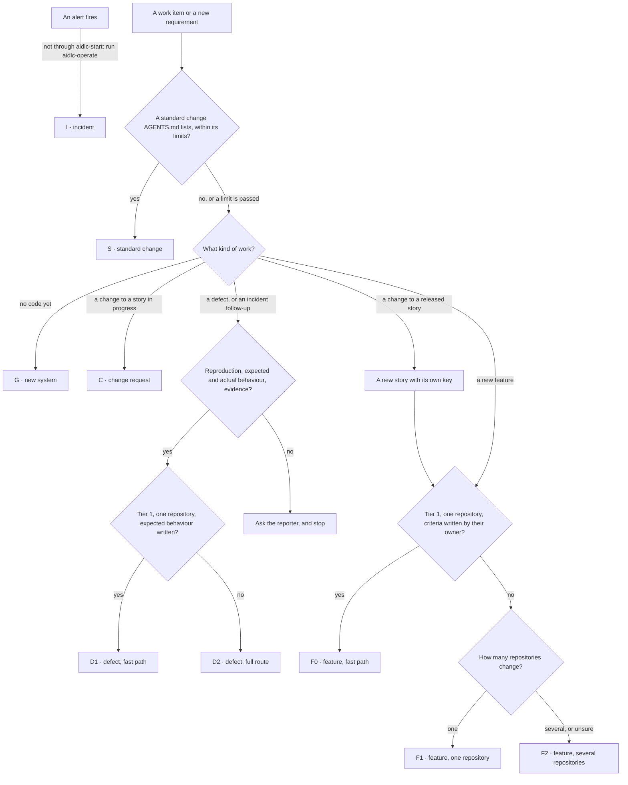

Three rules sit under the tree:

- **Unsure counts as several.** At a workspace root, an `explorer` agent goes into each repository and asks "would this
  work change you?". When the answers are unclear, the story runs at the root.
- **A released story is never edited.** A change to it is a new story whose criteria include "the original's criteria
  still hold".
- **The fast paths check twice.** `aidlc-start` checks what the work item shows. `aidlc-plan` (brief mode) checks
  what needs the code: for F0, the three design questions, a new dependency, a data change and the size; for D1, the
  written expected behaviour and the three design questions. `aidlc-build` stops on the brief's STOP IF as well. Any
  failure re-routes the work (see [Re-routing](#re-routing)).

## The routes at a glance

| Route | When | Stages | Approvals |
|---|---|---|---|
| F0 · feature, fast path | Tier 1, one repository, criteria written on the work item by their owner; no design change, new dependency or data change; one slice | start, plan (brief mode: `brief.md`), the engineer confirms, build, verify, review, merge | The engineer confirms the brief and its tier (Ready); a code owner approves brief and change in the pull request (Merge) |
| F1 · feature, one repository | A new capability or changed behaviour in one repository | start, intent (if needed), specify, discover (when needed), design, plan, build per slice, verify, review, release | Ready: the product owner and the spec owner, with the tier; at Tier 2 and 3, design and plan in one pull request (tech lead or architect); a code owner at Merge; the release approver when users see the change (always at Tier 3) |
| F2 · feature, several repositories | Two or more repositories, or unsure | Root: start, intent, specify, discover, design with the contract and the coordination plan. Each repository: plan, build, verify, review. Root: release | As F1; consumers approve contract changes; each repository's own code owner |
| C · change request | An approved criterion must change before release | specify (amendment), the criterion's owner decides, the tech lead classifies each part, then each part by its state | Criterion owner; tech lead; re-planned parts approved again |
| D1 · defect, fast path | Tier 1, one repository, reproduced, expected behaviour written | start, plan (brief mode: `fix.md`), the engineer confirms, build (reproducing test first), verify, review, merge | The engineer confirms the brief and its tier (Ready); a code owner approves brief and fix in the pull request (Merge) |
| D2 · defect, full route | Any defect that fails the fast-path test | As F1 or F2; the reproduction is the spec's first criterion | As F1; the product owner decides behaviour nobody wrote down |
| I · incident | An alert fires or an incident is open | operate (no story), people contain, the incident record and a follow-up item, feedback | On-call; a person runs every runbook step; the product owner accepts the follow-up |
| G · new system | No code yet | start, intent, specify, design (`new-system.md`), then per repository onboard (prepare), slice 0, onboard (confirm); then F1 or F2 and release | Architect or tech lead; consumers; the product owner for a wireframe |
| S · standard change | A class of work the team lists in `AGENTS.md`'s Standard changes, within every limit it names; Tier 1, one repository | start (it writes `standard.md`), the engineer confirms, build, verify, review, merge | The engineer confirms the standard brief and its tier (Ready); a code owner approves brief and change in the pull request (Merge) |

In every diagram below, a hexagon is a person's decision. The agent drafts every document; it never approves one.

### F0 · feature, fast path

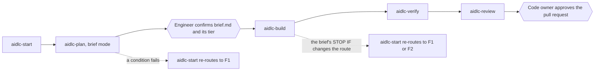

For a few lines of new behaviour that its owner has already written down. `aidlc-plan` writes one file,
`plans/<KEY>/brief.md`: the criteria, each mapped to a test, MAY CHANGE, STOP IF and the build mode. It replaces the
spec, the design note, the plan and the bundle. The brief is built as one slice named `brief`. There is no release
stage: the normal pipeline ships the change.

### F1 · feature, one repository

```mermaid
flowchart LR
    start["aidlc-start"] --> intent["aidlc-intent, if needed"]
    intent --> specify["aidlc-specify"]
    specify --> specok{{"Ready: the spec owner approves the spec, with its tier"}}
    specok --> discover["aidlc-discover, when needed"]
    discover --> design["aidlc-design"]
    design --> plan["aidlc-plan"]
    plan --> planok{{"Tech lead or architect approves, or records none needed, with the plan: one pull request at Tier 2 and 3, none at Tier 1"}}
    planok --> build["aidlc-build, one slice at a time"]
    build --> verify["aidlc-verify"]
    verify --> review["aidlc-review"]
    review --> merge{{"Code owner approves the pull request"}}
    merge --> release["aidlc-release"]
    release --> releaseok{{"Release approver"}}
```

Everything runs inside the repository, and every document lives in `plans/<KEY>/`, on the story's branch. At Tier 1 a
person decides only Ready and Merge, and Release only when users see the change: the plan and a "none needed" design are stated, and the code owner sees spec,
plan and code together in the pull request. At Tier 2 and 3 the spec, then the design with the plan, merge first;
each pull request approval is the record, and the AI writes the tracker entry from it, asking before posting (ADR
0026). The story's documents travel in the same pull request as the code at Tier 1.

### F2 · feature, several repositories

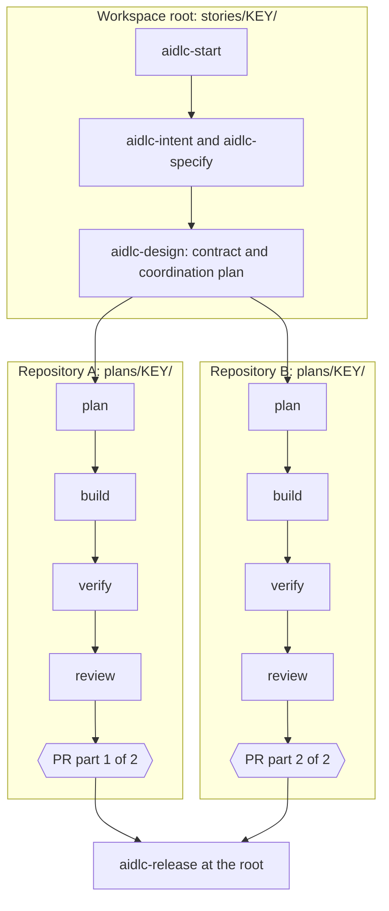

The story stays one tracker item. Each repository's share is a part: a row in `stories/<KEY>/coordination-plan.md`,
its own branch `feat/<KEY>-<part>` and its own pull request, titled `[<KEY>] part <n> of <m>: <what>`. At the root,
the AI reads every part's index on its repository's default branch with git and writes `stories/<KEY>/status.md`;
before release, `aidlc-release` fills one row per part from the same reads, and a person confirms each row.

### C · change request

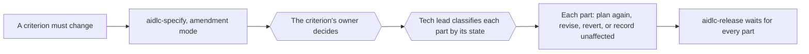

The change runs in the original story's index, never a new one. See
[A criterion changes after code exists](#a-criterion-changes-after-code-exists-c) for what happens to each part.

### D1 · defect, fast path

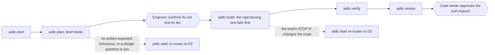

`plans/<KEY>/fix.md` holds the reproduction, the expected behaviour and where it is written, the actual behaviour,
MAY CHANGE and STOP IF. No release stage unless the fix changes data or a schema.

### D2 · defect, full route

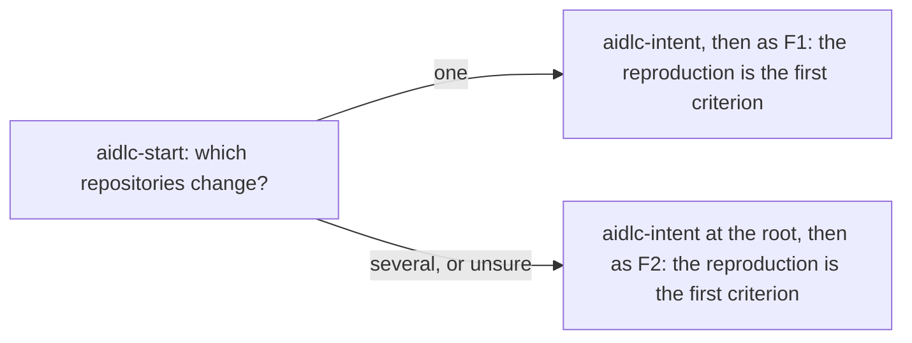

A defect that fails the fast-path test. When nobody wrote the expected behaviour down, the product owner decides it,
in the spec.

### I · incident

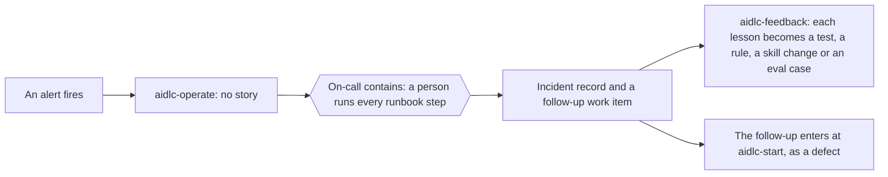

The agent diagnoses and proposes. It never acts on production.

### G · new system

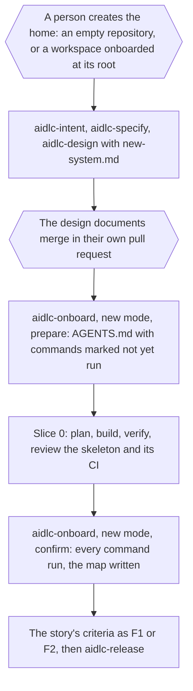

Each step's pull request merges before the next starts. With several repositories, a person creates each one the
design's layout names and runs `aidlc-onboard` again at the workspace root, so `WORKSPACE.md` lists them. Approving
`new-system.md` approves the dependencies and scaffold commands it pins.

### S · standard change

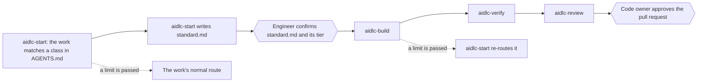

For work the tech lead approved once, as a class in the Standard changes section of `AGENTS.md` (ADR 0026).
`aidlc-onboard` proposes three classes: a recipe commit with an approved tool and version; a dependency patch or
minor bump within the team's policy (no new dependency, never a major version); and a D1 defect fix that stays Tier 1.
`aidlc-start` copies the class's name, limits and evidence into `plans/<KEY>/standard.md`, and the engineer confirms
it with its tier. There is no intent, spec, design or plan approval, and no release stage unless users see the
change. The code owner still approves the pull request after a non-author PASS; the evidence file names the class and
shows its limits held. For a listed recipe class, the build makes no separate recipe-review pause: the code owner
reads the recipe check at Merge. A defect that matches the D1-fix class takes route D1, whose fix brief already
carries its limits. Work that passes a limit takes its normal route: a class is never stretched.

## Linked parts (F2)

A contract change is drafted at the root, in `stories/<KEY>/contract/`, with a version, and its consumers approve
every change. The published contract lives in the provider's repository, and its owner applies the approved change. Each bundle pins the spec,
plan and contract versions it builds against.

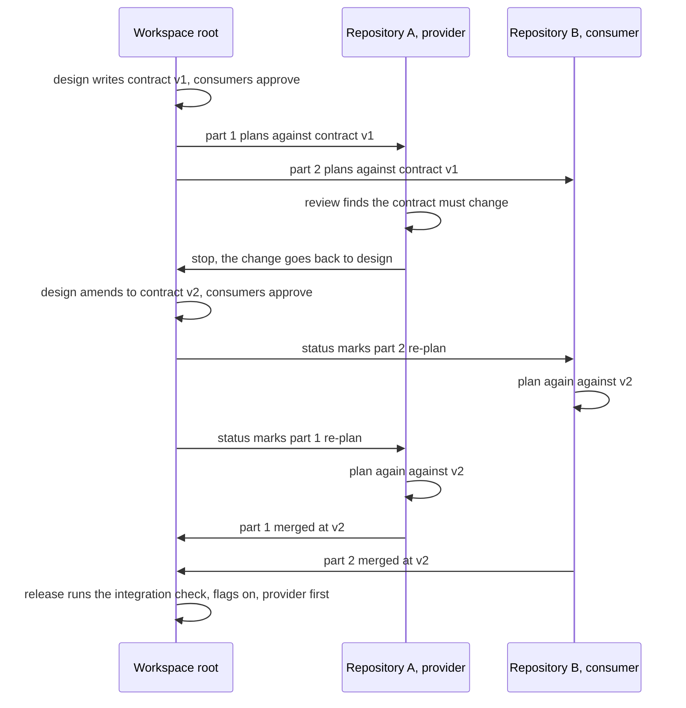

A review finding in one part is one of two kinds:

- **It leaves the contract unchanged.** Fix it in place. Consumer contract tests run in the provider's CI, so a fix
  that would break a consumer turns the provider's own pull request red.
- **It changes the contract, or the tier rises.** Stop: it is not fixed in that repository. `aidlc-design` amends the contract at the
  root, the consumers approve, and every part pinned to the old version is marked "re-plan".

## A criterion changes after code exists (C)

The tech lead classifies each part by its state; `status.md` flags every part whose bundle pins the old spec.

| Part's state | Action |
|---|---|
| Not started | Plans against the new version |
| Building or in review | Plans again on the same branch; the same pull request continues |
| Merged, flag off | A revision pull request, `[<KEY>] part <n> of <m>, revision <r>: <what>`, with a bundle pinned to the new version and its AMENDED ASSERTIONS; or a revert, if the code owner chooses |
| Unaffected | The tech lead decides why; the AI records it, as an `UNAFFECTED <repository> spec v<n>: <why>, <who>, <date>` line in the story index, with how it was confirmed |
| Released | Not a change request: a new story |

AMENDED ASSERTIONS are the only assertions a slice may change. Each one cites the spec version, the criterion and the
person who decided it. `aidlc-release` runs only when every part's merged bundle pins the current spec version, or
the part is recorded as unaffected.

## Re-routing

A fast path can fail after it starts, once `aidlc-plan` or `aidlc-build` reads the code. The stage stops, and you run `aidlc-start`
again on the same key.

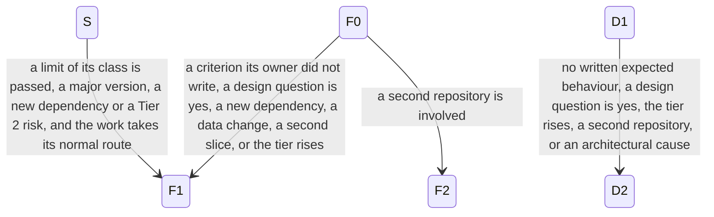

`aidlc-start` keeps every row already done, gives the new route's stages a "to do" row, and writes the ROUTE line as
`<new route>   (re-routed from <old route>, <date>: <reason>)`. The old brief stays as history. When the new route
spans several repositories, the story moves to `stories/<KEY>/` at the workspace root.

## Where the documents live

| Route | Story documents | Part documents | The index |
|---|---|---|---|
| F0, D1 | none: the brief stands in | `plans/<KEY>/brief.md` or `fix.md`, the progress note | `plans/<KEY>/README.md` |
| S | none: the standard brief stands in | `plans/<KEY>/standard.md`, the progress note | `plans/<KEY>/README.md` |
| F1, D2 in one repository, C on such a story | `plans/<KEY>/`: intent, spec, evidence pack, design note, plan, bundles | progress notes, in the same folder | `plans/<KEY>/README.md` |
| F2, D2 across repositories, C on such a story | `stories/<KEY>/` at the root: intent, spec, evidence pack, design, contract, coordination plan | `plans/<KEY>/` in each repository | one per repository, plus `stories/<KEY>/status.md`, derived |
| G | the design documents and `new-system.md` in the home | slice 0's bundle and progress note | as F1 or F2 |
| I | `incidents/<ID>/` | none | none: the follow-up item starts its own |

Each stage's other outputs (the evidence table, the pull-request description, the review record, the readiness and
change records, the compatibility matrix) sit beside these, as each skill's Produces section says.
