# Adoption guide and routes documents Implementation Plan (Plan 17)

> **For agentic workers:** REQUIRED SUB-SKILL: Use superpowers:subagent-driven-development (recommended) or superpowers:executing-plans to implement this plan task-by-task. Steps use checkbox (`- [ ]`) syntax for tracking.

**Goal:** A team can see how each of the eight routes runs, and how to adopt aidlc on a new or an existing system, from two documents that the README and every quickstart point to.

**Architecture:** Two new Markdown documents under `docs/operating-model/`, with Mermaid diagrams; small link edits to the README, the three quickstarts and two operating-model pages. One new test file, `scripts/test_docs.py`, pins them: the documents exist, cover every route `using-aidlc` lists, keep their Mermaid in a safe subset, and are linked. No skill changes.

**Tech Stack:** Markdown, Mermaid (rendered by the git host), Python 3.12 standard library (`unittest`).

**Spec:** `docs/design/2026-11-08-aidlc-4-routes-and-roadmap.md` (section "Plan 17: adoption guide and routes documents"; the facts come from "The routes", "Linked parts (F2)" and "A criterion changes after code exists (C)", and from Plans 13 and 15). Builds on `main` at f8e093c (aidlc 4.3.0; Plan 16 parked).

Branch: `docs/plan-17-adoption-routes`.

## Decisions this plan makes where the spec is silent

| Question | Decision | Why |
|---|---|---|
| Version | None: the plugin stays at 4.3.0 | The spec's versions row: "Plan 17: documents only" |
| Mermaid subset | `flowchart`, `sequenceDiagram` and `stateDiagram-v2` only; every node label and edge label in double quotes | Quoted labels are the one rule that keeps parentheses, colons and slashes from breaking a diagram; a test enforces it, because nothing here renders Mermaid |
| Rendering check | A stdlib lint in the tests, then the final reviewer reads each diagram. An optional render with the Mermaid CLI runs only if the owner approves fetching it (it is a new tool) | No new dependency without asking |
| Build modes and the slice runner | Described in `adoption.md` (a later phase), not in `routes.md` | Modes belong to slices, not routes; they are a step in adoption once the autonomy check passes |
| The parked practice work | Not mentioned in either document | Documents describe what the kit does today |

## Global Constraints

- Facts match the skills as they are on `main` (aidlc 4.3.0). Where a document and a skill disagree, the skill wins and the document is fixed.
- Short sentences, British spelling, plain words. No third-party project, author or URL. No marketing.
- Every Mermaid block uses the subset above; every node and edge label is quoted.
- Never change an existing test assertion: every `scripts/test_*.py` test keeps passing unchanged; new checks are new tests.
- No change under `plugins/` or `starter/`. Commits use the noreply identity and end with `Co-Authored-By: Claude Opus 5.5 <noreply@anthropic.com>`.

## Review Focus

- A route drawn with a stage, a gate or an approver the skills do not have, or missing one they do. A person following the diagram expects the skills to behave the same; the reviewer compares each diagram with `using-aidlc`, `aidlc-start` and the stage skills. Task 1 adds `test_every_route_in_using_aidlc_has_a_section`.
- A Mermaid block that does not render on the git host. A person expects every diagram to draw; Task 1 adds `test_mermaid_blocks_use_the_safe_subset`, and the reviewer reads each block.
- The adoption phases asking a team to do something no skill supports (for example running AI review on pull requests the kit did not produce). A person expects each phase to name the skill or starter file that does it; Task 2 adds `test_each_phase_names_its_skills`.
- The approvals sheet naming an approver who is not the one the skills name (for example the engineer approving a plan). A person expects one answer; Task 2 adds `test_the_sheet_never_lets_the_author_approve`.
- A link that points nowhere. Task 3 adds `test_links_in_the_new_documents_resolve`.

---

### Task 1: `docs/operating-model/routes.md`

**Files:**
- Create: `docs/operating-model/routes.md`, `scripts/test_docs.py`

**Interfaces:**
- Produces: `scripts/test_docs.py` with `read(rel)`, `mermaid_blocks(text)` and `class DocsTest`; later tasks append inside it.

- [ ] **Step 1: Write the failing tests.** Create `scripts/test_docs.py`:

```python
"""Plan 17: the routes and adoption documents exist, match the skills, keep Mermaid safe, and are linked."""
import re
import unittest
from pathlib import Path

ROOT = Path(__file__).resolve().parents[1]
ROUTES = "docs/operating-model/routes.md"
ADOPTION = "docs/operating-model/adoption.md"
KINDS = ("flowchart", "sequenceDiagram", "stateDiagram-v2")


def read(rel: str) -> str:
    return (ROOT / rel).read_text(encoding="utf-8")


def mermaid_blocks(text: str) -> list[str]:
    return re.findall(r"```mermaid\n(.*?)```", text, re.S)


class DocsTest(unittest.TestCase):
    def test_every_route_in_using_aidlc_has_a_section(self):
        codes = re.findall(r"^\| (F0|F1|F2|C|D1|D2|I|G) · ", read("plugins/aidlc/skills/using-aidlc/SKILL.md"), re.M)
        self.assertEqual(len(codes), 8)
        routes = read(ROUTES)
        for code in codes:
            self.assertRegex(routes, rf"(?m)^### {code} · ", code)

    def test_routes_covers_choice_parts_amendments_and_re_routing(self):
        routes = read(ROUTES)
        for heading in ("## Choosing a route", "## Linked parts (F2)", "## A criterion changes after code exists (C)",
                        "## Re-routing", "## Where the documents live"):
            self.assertIn(heading, routes)
        self.assertGreaterEqual(len(mermaid_blocks(routes)), 10)

    def test_mermaid_blocks_use_the_safe_subset(self):
        for rel in (ROUTES, ADOPTION):
            if not (ROOT / rel).is_file():
                continue
            for block in mermaid_blocks(read(rel)):
                lines = [line for line in block.splitlines() if line.strip()]
                self.assertTrue(lines[0].split()[0] in KINDS, f"{rel}: {lines[0]}")
                if lines[0].startswith("flowchart"):
                    for line in lines[1:]:
                        bare = re.search(r"\w(\{\{|\(\[|\(\(|\[|\{|\()(?=[^\"{\[(])", line)
                        self.assertIsNone(bare, f"{rel}: unquoted node label: {line.strip()}")
                        edge = re.search(r"\|(?!\")[^|]*\|", line)
                        self.assertIsNone(edge, f"{rel}: unquoted edge label: {line.strip()}")
                        if line.strip().startswith("subgraph"):
                            self.assertRegex(line, r'subgraph \w+ \["[^"]+"\]', f"{rel}: {line.strip()}")


if __name__ == "__main__":
    unittest.main()
```

- [ ] **Step 2: Run them and watch them fail.**

Run: `python3 -m unittest scripts.test_docs 2>&1 | tail -1`
Expected: `FAILED (errors=2)` (no `routes.md`); the subset test passes vacuously until a document exists.

- [ ] **Step 3: Write `docs/operating-model/routes.md`** with exactly this content:

````markdown
# Routes

`aidlc-start` sends every piece of work down one of eight routes. It asks two questions: what kind of work is this,
and how many repositories does it change? The answer fixes which stages run, where their documents live, and who
approves.

The `using-aidlc` skill holds the same routes as a table. This page draws them.

## Choosing a route

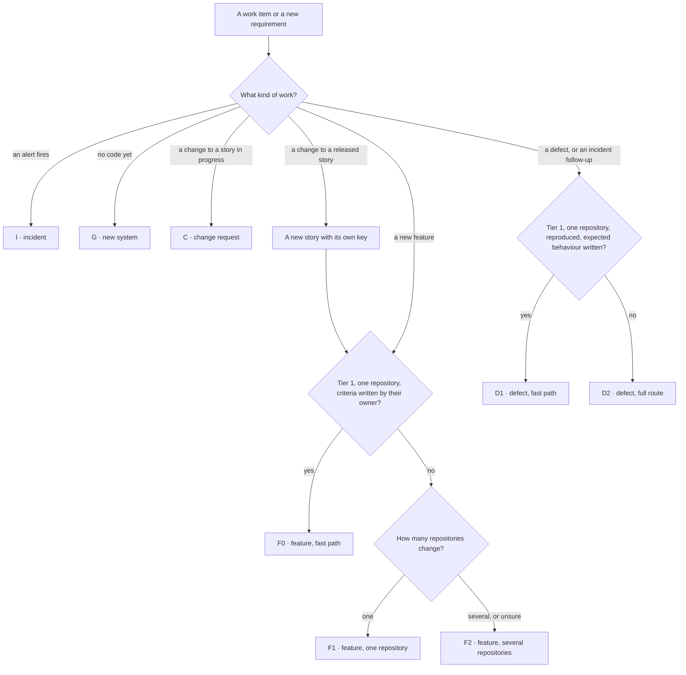

Three rules sit under the tree:

- **Unsure counts as several.** At a workspace root, one `explorer` agent asks each repository "would this work change
  you?". When the answers are unclear, the story runs at the root.
- **A released story is never edited.** A change to it is a new story whose criteria include "the original's criteria
  still hold".
- **The fast paths check twice.** `aidlc-start` checks what the work item shows. `aidlc-plan` checks what needs the
  code: the three design questions, a new dependency, a data change, the size. Any failure re-routes the work (see
  [Re-routing](#re-routing)).

## The routes at a glance

| Route | When | Stages | Approvals |
|---|---|---|---|
| F0 · feature, fast path | Tier 1, one repository, criteria written on the work item by their owner; no design change, new dependency or data change; one slice | start, plan (brief mode: `brief.md`), the engineer confirms, build, verify, review, merge | The engineer confirms the brief; a code owner approves brief and change in the pull request |
| F1 · feature, one repository | A new capability or changed behaviour in one repository | start, intent (if needed), specify, discover (when needed), design, plan, build per slice, verify, review, release | Product owner, spec owner, tech lead (design and plan) on the tracker; a code owner approves the pull request; the release approver |
| F2 · feature, several repositories | Two or more repositories, or unsure | Root: start, intent, specify, discover, design with the contract and the coordination plan. Each repository: plan, build, verify, review. Root: release | As F1; consumers approve contract changes; each repository's own code owner |
| C · change request | An approved criterion must change before release | specify (amendment), the criterion's owner decides, the tech lead classifies each part, then each part by its state | Criterion owner; tech lead; re-planned parts approved again |
| D1 · defect, fast path | Tier 1, one repository, reproduced, expected behaviour written | start, plan (brief mode: `fix.md`), the engineer confirms, build (reproducing test first), verify, review, merge | The engineer confirms the brief; a code owner approves brief and fix in the pull request |
| D2 · defect, full route | Any defect that fails the fast-path test | As F1 or F2; the reproduction is the spec's first criterion | As F1; the product owner decides behaviour nobody wrote down |
| I · incident | An alert fires or an incident is open | operate (no story), people contain, the incident record and a follow-up item, feedback | On-call; a person runs every runbook step; the product owner accepts the follow-up |
| G · new system | No code yet | start, intent, specify, design (`new-system.md`), then per repository onboard (prepare), slice 0, onboard (confirm); then F1 or F2 and release | Architect or tech lead; consumers; the product owner for a wireframe |

In every diagram below, a hexagon is a person's decision. The agent drafts every document; it never approves one.

### F0 · feature, fast path

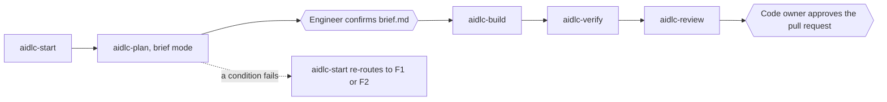

For a few lines of new behaviour that its owner has already written down. `aidlc-plan` writes one file,
`plans/<KEY>/brief.md`: the criteria, each mapped to a test, MAY CHANGE, STOP IF and the build mode. It replaces the
spec, the design note, the plan and the bundle. The brief is built as one slice named `brief`. There is no release
stage: the normal pipeline ships the change.

### F1 · feature, one repository

```mermaid
flowchart LR
    start["aidlc-start"] --> intent["aidlc-intent, if needed"]
    intent --> specify["aidlc-specify"]
    specify --> specok{{"Spec owner approves the spec"}}
    specok --> discover["aidlc-discover, when needed"]
    discover --> design["aidlc-design"]
    design --> designok{{"Tech lead approves, or records none needed"}}
    designok --> plan["aidlc-plan"]
    plan --> planok{{"Tech lead approves plan and bundles"}}
    planok --> build["aidlc-build, one slice at a time"]
    build --> verify["aidlc-verify"]
    verify --> review["aidlc-review"]
    review --> merge{{"Code owner approves the pull request"}}
    merge --> release["aidlc-release"]
    release --> releaseok{{"Release approver"}}
```

Everything runs inside the repository, and every document lives in `plans/<KEY>/`, on the story's branch. Approvals
are recorded on the tracker with the document's version and commit. The story's documents travel in the same pull
request as the code.

### F2 · feature, several repositories

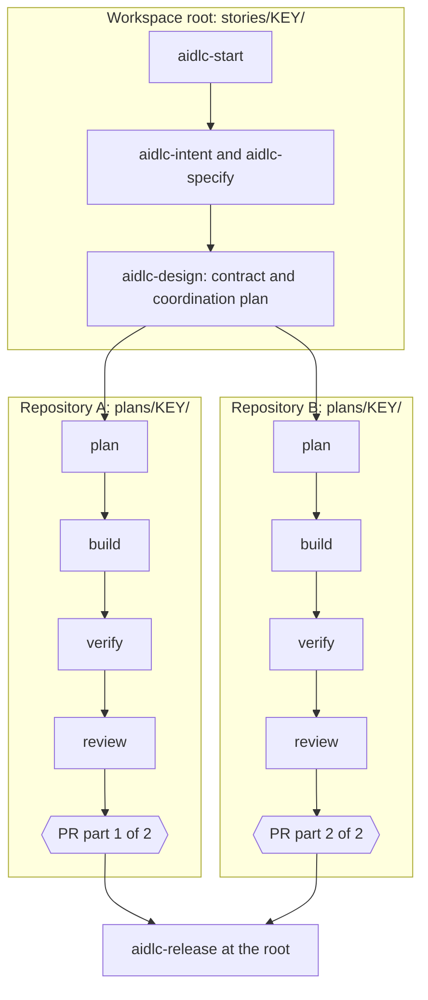

The story stays one tracker item. Each repository's share is a part: a row in `stories/<KEY>/coordination-plan.md`,
its own branch `feat/<KEY>-<part>` and its own pull request, titled `[<KEY>] part <n> of <m>: <what>`. At the root,
`python3 scripts/story_status.py <KEY>` reads every part's index and writes `stories/<KEY>/status.md`.

### C · change request

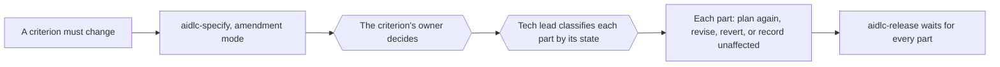

The change runs in the original story's index, never a new one. See
[A criterion changes after code exists](#a-criterion-changes-after-code-exists-c) for what happens to each part.

### D1 · defect, fast path

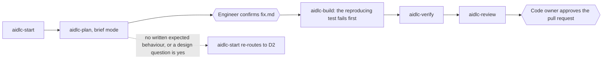

`plans/<KEY>/fix.md` holds the reproduction, the expected behaviour and where it is written, the actual behaviour,
MAY CHANGE and STOP IF. No release stage unless the fix changes data or a schema.

### D2 · defect, full route

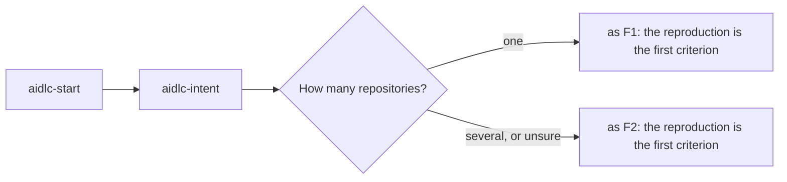

A defect that fails the fast-path test. When nobody wrote the expected behaviour down, the product owner decides it,
in the spec.

### I · incident

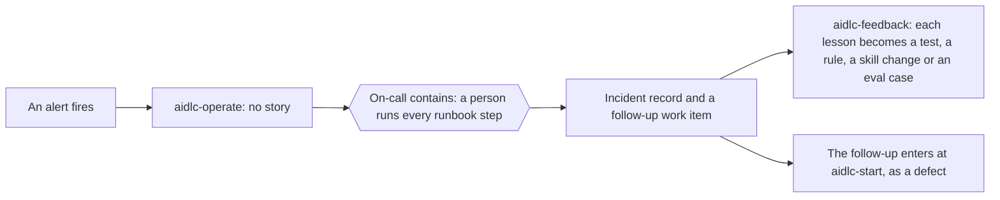

The agent diagnoses and proposes. It never acts on production.

### G · new system

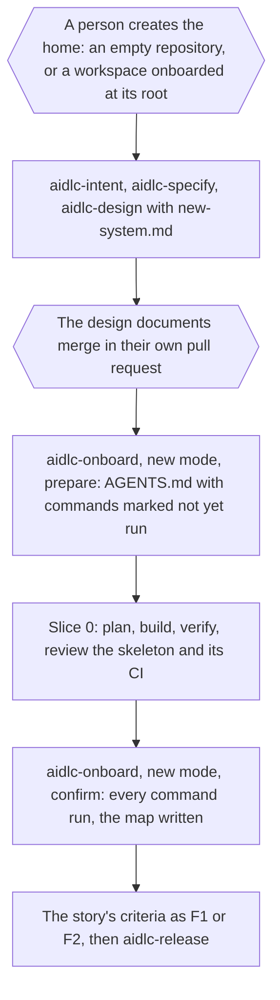

Each step's pull request merges before the next starts. With several repositories, a person creates each one the
design's layout names and runs `aidlc-onboard` again at the workspace root, so `WORKSPACE.md` lists them. Approving
`new-system.md` approves the dependencies and scaffold commands it pins.

## Linked parts (F2)

The contract lives at the root, has a version, and its consumers approve every change. Each bundle pins the spec,
plan and contract versions it builds against.

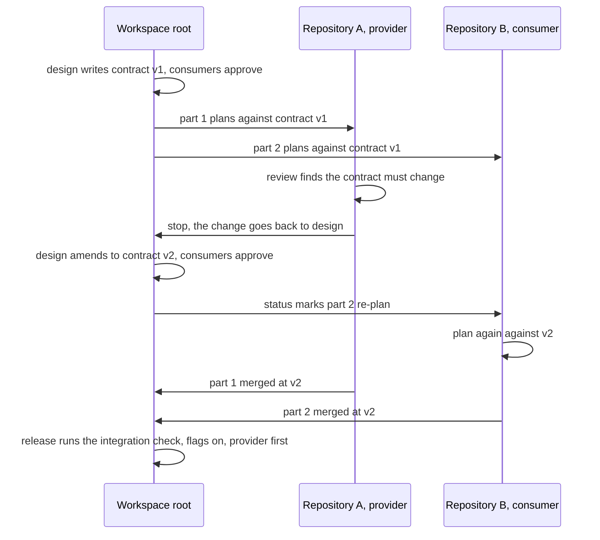

A review finding in one part is one of two kinds:

- **It leaves the contract unchanged.** Fix it in place. Consumer contract tests run in the provider's CI, so a fix
  that would break a consumer turns the provider's own pull request red.
- **It changes the contract.** Stop: it is not fixed in that repository. `aidlc-design` amends the contract at the
  root, the consumers approve, and every part pinned to the old version is marked "re-plan".

## A criterion changes after code exists (C)

The tech lead classifies each part by its state; the status script flags every part whose bundle pins the old spec.

| Part's state | Action |
|---|---|
| Not started | Plans against the new version |
| Building or in review | Plans again on the same branch; the same pull request continues |
| Merged, flag off | A revision pull request, `[<KEY>] part <n> of <m>, revision <r>`, with a bundle pinned to the new version and its AMENDED ASSERTIONS; or a revert, if the code owner chooses |
| Unaffected | The tech lead records why, on the tracker |
| Released | Not a change request: a new story |

AMENDED ASSERTIONS are the only assertions a slice may change. Each one cites the spec version, the criterion and the
person who decided it. `aidlc-release` runs only when every part's merged bundle pins the current spec version, or
the part is recorded as unaffected.

## Re-routing

A fast path can fail after it starts, once `aidlc-plan` reads the code. The stage stops, and you run `aidlc-start`
again on the same key.

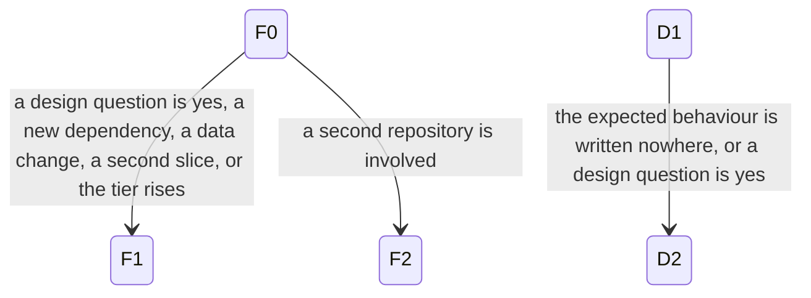

`aidlc-start` keeps every row already done, gives the new route's stages a "to do" row, and writes the ROUTE line as
`<new route>   (re-routed from <old route>, <date>: <reason>)`. The old brief stays as history. When the new route
spans several repositories, the story moves to `stories/<KEY>/` at the workspace root.

## Where the documents live

| Route | Story documents | Part documents | The index |
|---|---|---|---|
| F0, D1 | none: the brief stands in | `plans/<KEY>/brief.md` or `fix.md`, the progress note | `plans/<KEY>/README.md` |
| F1, D2 in one repository, C on such a story | `plans/<KEY>/`: intent, spec, evidence pack, design note, plan, bundles | progress notes, in the same folder | `plans/<KEY>/README.md` |
| F2, D2 across repositories, C on such a story | `stories/<KEY>/` at the root: intent, spec, design, contract, coordination plan | `plans/<KEY>/` in each repository | one per repository, plus `stories/<KEY>/status.md`, derived |
| G | the design documents and `new-system.md` in the home | slice 0's bundle and progress note | as F1 or F2 |
| I | `incidents/<ID>/` | none | none: the follow-up item starts its own |
````

- [ ] **Step 4: Run all tests.** Expected: `OK` (304 + 3).

- [ ] **Step 5: Commit.**

```bash
git add docs/operating-model/routes.md scripts/test_docs.py
git commit -m "docs(operating-model): routes.md, the eight routes as diagrams

Co-Authored-By: Claude Opus 5.5 <noreply@anthropic.com>"
```

---

### Task 2: `docs/operating-model/adoption.md`

**Files:**
- Create: `docs/operating-model/adoption.md`
- Test: `scripts/test_docs.py`

- [ ] **Step 1: Write the failing tests.** Append inside `class DocsTest`:

```python
    def test_adoption_covers_day_0_the_phases_and_the_sheet(self):
        adoption = read(ADOPTION)
        for heading in ("## Before you start", "## A new system: day 0", "## An existing system, in phases",
                        "### Phase 1: onboard, and value at low risk", "### Phase 2: pin the code you will change",
                        "### Phase 3: the full routes for new work", "### Phase 4: raise the bar, then delegate",
                        "## Who approves what"):
            self.assertIn(heading, adoption)

    def test_each_phase_names_its_skills(self):
        adoption = read(ADOPTION)
        for phase, skills in (("### Phase 1", ("aidlc-onboard", "aidlc-review", "aidlc-start")),
                              ("### Phase 2", ("writing-tests", "aidlc-discover")),
                              ("### Phase 3", ("aidlc-specify", "aidlc-plan", "aidlc-release")),
                              ("### Phase 4", ("Quality bar", "run_slices.py"))):
            start = adoption.index(phase)
            end = adoption.find("### Phase", start + 10)
            body = adoption[start:end if end > 0 else len(adoption)]
            for name in skills:
                self.assertIn(name, body, f"{phase}: {name}")

    def test_the_sheet_never_lets_the_author_approve(self):
        sheet = read(ADOPTION).split("## Who approves what", 1)[1]
        rows = [line for line in sheet.splitlines() if line.startswith("| ") and not line.startswith("| Decision")]
        self.assertGreaterEqual(len(rows), 15)
        self.assertIn("never the author", sheet)
        for row in rows:
            self.assertNotRegex(row.split("|")[2], r"(?i)\bagent\b|\bAI\b")
```

- [ ] **Step 2: Run them and watch them fail.** Expected: 3 ERROR (no `adoption.md`).

- [ ] **Step 3: Write `docs/operating-model/adoption.md`** with exactly this content:

````markdown
# Adopting aidlc

How a team starts with aidlc: on a new system from day 0, or on an existing one in phases. The last section is a
one-page sheet of who approves what.

## Before you start

You need four things, whatever the system:

- **A tracker** the agent can read (read-only), where approvals are recorded with each document's version.
- **CI** that runs the repository's tests on every pull request, and branch protection that requires it.
- **Code owners** for every path, and a rule that the author never approves their own change.
- **Someone who owns the rules file** (`AGENTS.md`) and keeps it true.

Then install the plugin and copy the starter files ([quickstarts](../quickstart/)). The
[autonomy check](autonomy-and-maturity.md) decides how much the agent may do on its own; it starts small.

## A new system: day 0

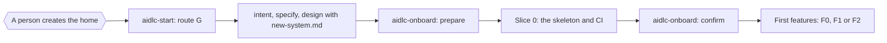

1. **A person creates the home.** One repository when the system is one repository. A workspace, onboarded at its
   root, when it is several or undecided. The agent never creates a repository.
2. **Run `aidlc-start`.** In an empty home it chooses route G.
3. **Decide the system.** `aidlc-intent`, `aidlc-specify` and `aidlc-design` write the story, the first criteria and
   `new-system.md`: the stack, every dependency pinned, the repository layout, the contracts, the commands and the
   scaffold. Approving it approves those dependencies and commands. These documents merge on their own.
4. **Prepare.** `aidlc-onboard` (new mode) copies the starter files and writes `AGENTS.md`, each command marked
   `(not yet run)`. A person turns on branch protection that requires a code owner.
5. **Slice 0.** `aidlc-plan`, `aidlc-build`, `aidlc-verify` and `aidlc-review` build the skeleton under the usual
   gates: the scaffold recipe, one real test, a health check and CI.
6. **Confirm.** `aidlc-onboard` runs every command, clears the marks and writes the map. A person makes slice 0's
   checks required.
7. **Build the first features** as F0, F1 or F2. From here the repository is ordinary.

## An existing system, in phases

Do not switch everything on at once. Each phase pays for itself and earns the next.

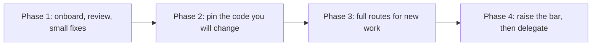

### Phase 1: onboard, and value at low risk

- Run `aidlc-onboard` once per repository: it writes `AGENTS.md`, the codebase map, the Legacy list (code with no
  tests that pin it) and today's Quality bar values under Measured. Review both files in a pull request.
- Copy the starter's `ai-review.yml` so the reviewer agents comment on every pull request, including ones the kit did
  not produce. `aidlc-review` turns the findings into a review record for kit-built changes. AI review is evidence
  for the code owner, never the approval.
- Send bugs through `aidlc-start`. Tier 1 bugs with a written expected behaviour take D1: a brief, a reproducing test,
  a fix.

Exit when `AGENTS.md` answers the onboarding probe questions and D1 fixes merge without surprises.

### Phase 2: pin the code you will change

- Before changing code on the Legacy list, record what it does today with characterisation tests (the
  `writing-tests` practice). `aidlc-build` stops on legacy code that has no such test.
- Use `aidlc-discover` where the change touches code nobody understands well: it gathers evidence read-only and
  lists the untested paths as findings.

Exit when the areas on next quarter's roadmap have their behaviour pinned.

### Phase 3: the full routes for new work

- New features take F0, F1 or F2; change requests take C; other defects take D2. `aidlc-specify` writes testable
  criteria, `aidlc-design` records the decisions (most end at "none needed"), `aidlc-plan` slices the work into
  bundles the tech lead approves, and `aidlc-release` ships with stop criteria.
- When a change spans repositories, set up a workspace (`starter/workspace/`, then `aidlc-onboard` at its root) and
  track the story there.

Exit when stories run end to end with their approvals on the tracker.

### Phase 4: raise the bar, then delegate

- Move each Quality bar dimension from Measured to Enforced once it has a check command, and ratchet it: coverage no
  lower than today, size and latency within a set margin. An exception needs a reason, an owner, an expiry date and a
  person's approval.
- When a repository passes the [autonomy check](autonomy-and-maturity.md), let the tech lead approve delegate modes in
  bundles, within the tier: delegate with checkpoints at Tiers 1 and 2, delegate at Tier 1. Run approved delegate
  slices with the starter's `scripts/run_slices.py`: one fresh session per slice, stopping at the first that does
  not finish. You review the diffs at the end and push.

Tier 3 stays hands-on at every phase.

## Who approves what

The agent drafts every document and decides nothing on this sheet. Nobody approves what they wrote: never the
author, never the author's agent, never an AI reviewer.

| Decision | Who | Where it is recorded |
|---|---|---|
| The story and its acceptance criteria | Product owner | The tracker |
| The route | Tech lead agrees what `aidlc-start` proposes | The story's index |
| The spec | Spec owner (specialists at Tier 3) | The tracker, with the spec's version |
| A changed criterion | The criterion's owner | The spec's Amendments line |
| Which parts a change affects | Tech lead | The tracker |
| Design decisions, or "none needed" | Tech lead or architect | The tracker; ADRs in `docs/adr/` |
| A contract change | Every consumer | The tracker, with the contract's version |
| A new system's stack and dependencies | Architect or tech lead | The tracker, approving `new-system.md` |
| The plan and its bundles, including each MODE | Tech lead | The tracker, with the plan's version and commit |
| A fast-path brief (`fix.md`, `brief.md`) | The engineer confirms; a code owner approves | The CONFIRMED line; the pull request |
| A recipe commit (a tool's mechanical output) | The engineer reviews it as generated code | The pull request |
| Passing a checkpoint in a delegated slice | The engineer | The progress note's "confirmed by" line |
| A new dependency | A person, asked first | The plan or the pull request |
| An exception to the Quality bar | A person, with a reason, an owner and an expiry date | Next to the code, or in `AGENTS.md`'s Quality bar |
| The merge | A code owner who did not write or push the change | The pull request |
| Required checks and branch protection | A repository administrator | The git host |
| The release | Release approver (named at Tier 3) | The change record |
| Containment of an incident | On-call; a person runs every runbook step | The incident record |
| Where each lesson goes | The owner of each source | The feedback record |

Tiers add approvers, never stages: see [roles.md](roles.md) and [tiers.md](tiers.md).
````

- [ ] **Step 4: Run all tests.** Expected: `OK`.

- [ ] **Step 5: Commit.**

```bash
git add docs/operating-model/adoption.md scripts/test_docs.py
git commit -m "docs(operating-model): adoption.md, day 0, the brownfield phases and who approves what

Co-Authored-By: Claude Opus 5.5 <noreply@anthropic.com>"
```

---

### Task 3: Links from the README, the quickstarts and the operating model

**Files:**
- Modify: `README.md`, `docs/quickstart/claude-code.md`, `docs/quickstart/copilot.md`, `docs/quickstart/codex-cursor.md`, `docs/operating-model/lifecycle.md`, `docs/operating-model/workspace-and-repositories.md`
- Test: `scripts/test_docs.py`

- [ ] **Step 1: Write the failing tests.** Append inside `class DocsTest`:

```python
    def test_the_readme_and_every_quickstart_point_to_both(self):
        self.assertIn("docs/operating-model/routes.md", read("README.md"))
        self.assertIn("docs/operating-model/adoption.md", read("README.md"))
        for rel in ("docs/quickstart/claude-code.md", "docs/quickstart/copilot.md", "docs/quickstart/codex-cursor.md"):
            text = read(rel)
            self.assertIn("../operating-model/routes.md", text, rel)
            self.assertIn("../operating-model/adoption.md", text, rel)

    def test_no_document_still_waits_for_plan_17(self):
        self.assertNotIn("arrive in `routes.md` with Plan 17", read("docs/operating-model/lifecycle.md"))
        self.assertNotIn("Plan 17", read("docs/operating-model/workspace-and-repositories.md"))

    def test_links_in_the_new_documents_resolve(self):
        for rel in (ROUTES, ADOPTION):
            base = (ROOT / rel).parent
            for target in re.findall(r"\]\(([^)#]+)(?:#[^)]*)?\)", read(rel)):
                self.assertTrue((base / target).exists(), f"{rel}: {target}")
```

- [ ] **Step 2: Run them and watch them fail.** Expected: 2 FAIL (the link test passes once Tasks 1 and 2 are done).

- [ ] **Step 3: Edit the links.**
  - `README.md`: replace "The operating model: [docs/operating-model/workspace-and-repositories.md](docs/operating-model/workspace-and-repositories.md)." with "The eight routes, drawn: [docs/operating-model/routes.md](docs/operating-model/routes.md). How to adopt aidlc on a new or an existing system, and who approves what: [docs/operating-model/adoption.md](docs/operating-model/adoption.md). The operating model: [docs/operating-model/workspace-and-repositories.md](docs/operating-model/workspace-and-repositories.md)."
  - Each quickstart: add at the end a paragraph: "Next: [how to adopt aidlc](../operating-model/adoption.md), on a new system or an existing one in phases, and [the eight routes](../operating-model/routes.md) `aidlc-start` chooses from."
  - `lifecycle.md`: replace "the route table is in the `using-aidlc` skill, and the diagrams arrive in `routes.md` with Plan 17." with "the route table is in the `using-aidlc` skill, and [routes.md](routes.md) draws each route."
  - `workspace-and-repositories.md`: replace "(routes: see `routes.md`, Plan 17)" with "(routes: see [routes.md](routes.md))".

- [ ] **Step 4: Run every check.**

```bash
python3 -m unittest discover -s scripts -p 'test_*.py' 2>&1 | tail -3
python3 scripts/validate.py | tail -1
claude plugin validate .
```

Expected: `OK`; 0 problems; `Validation passed`.

- [ ] **Step 5: Commit.**

```bash
git add README.md docs scripts/test_docs.py
git commit -m "docs: the README, the quickstarts and the operating model point to routes.md and adoption.md

Co-Authored-By: Claude Opus 5.5 <noreply@anthropic.com>"
```

- [ ] **Step 6: Final review.** A fresh reviewer on the most capable model reads the branch against the spec's Plan 17 section, the skills on `main` (each route against `using-aidlc`, `aidlc-start` and the stage skills; the sheet against every stage's Gate) and the Review Focus above, and reads every Mermaid block for syntax. Fix critical, important and cheap real low findings test-first; dismiss other lows with a reason.

- [ ] **Step 7: Optional render check, only with the owner's approval** (it fetches the Mermaid CLI, a new tool): render each block and confirm none fails. Without approval, the record says the diagrams were linted and read, not rendered.

- [ ] **Step 8: Write the verification record** `docs/verification/2026-11-08-plan-17-adoption-routes.md` in Plan 15's layout: the checks, the Review Focus cases with their tests, the review's findings and fixes, the render result or its absence, and the decisions. Commit it with the fix pass.
