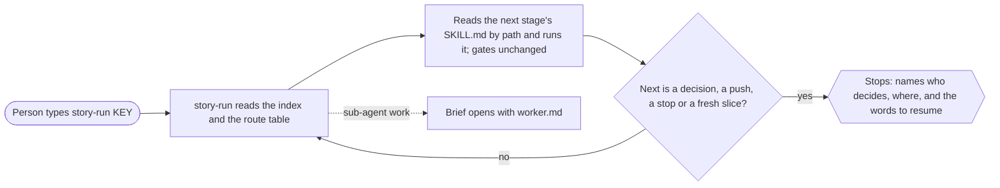

# pstack and aidlc: how each connects its pieces, and what aidlc should adapt

Read-only review, 2026-11-22. aidlc at local `main` (29a5b2a, aidlc 7.2.0). pstack read from `cursor/plugins`,
folder `pstack`, branch `main`, through `gh api`. A pstack path below is relative to `pstack/`. An aidlc path is
relative to the repository root. `file:N` means line N.

## Summary

aidlc is not disconnected inside a stage. Gates, loads and references are tight, and tests pin them. It is
disconnected **between** stages. ADR 0026 cut a person's stops down to the decisions table. But a person still starts
every stage by hand. At Tier 1 on route F1, a person makes two decisions (Ready and Merge). They type about ten
commands to get there. pstack's main structural idea is one entry skill that a person starts once. It finds the
steps for the task and pulls in the rest by path. That idea fits aidlc if it stops at aidlc's decisions, not at
pstack's. The smallest useful change is one new workflow skill, `story-run`. It reads the story's index, runs the
next stage by reading its `SKILL.md` in full, and goes on until the next decision in the tiers table. Every gate
stays where it is.

## 1. How each package connects its pieces

| Concern | pstack | aidlc today |
|---|---|---|
| Who starts what | A person starts one skill, `poteto-mode` (`skills/poteto-mode/SKILL.md:4`, `disable-model-invocation: true`; `README.md:47`). 57 of its 58 skills are person-only. Only `setup-pstack` is not. The mode reads the others by path (`docs/harness/claude-code.md:12`). | A person starts each stage by name (`docs/adr/0005-skills-plugin.md:35-37`; `skills/using-aidlc/SKILL.md:12`). 11 of 13 stages have `disable-model-invocation: true`. `aidlc-onboard` and `aidlc-verify` can start on their own. `parallel-lanes` is person-started too. The README lists 14 commands a person types (`README.md:71-91`). |
| How a task finds its steps | The mode matches the task to one of 22 playbooks and copies its steps into the todo list (`skills/poteto-mode/SKILL.md:106-110`). If nothing fits, `figure-it-out` designs a playbook (`skills/figure-it-out/SKILL.md:9`). | `aidlc-start` picks one of nine routes and writes one index row per stage (`skills/aidlc-start/SKILL.md:78-118`; `skills/aidlc-start/assets/story-index.md:29-31`). Then it tells the person the next command (`skills/aidlc-start/SKILL.md:134`). Each later stage marks its own row and ends. Only a `parallel-lanes` lane reads "the next unfinished stage" from the index (`skills/parallel-lanes/SKILL.md:135-138`). |
| How rules reach the agent | One inline index of 24 named principles, each with a "when it applies" trigger (`skills/poteto-mode/SKILL.md:31-72`). The agent reads a principle's own file when it applies one and names it in the reply (`:15`). Each rule lives once, in `principle-<name>/SKILL.md`. | Each skill carries its own Rules, Common excuses and Red flags (`AGENTS.md:24-31`). Shared rules are repeated. "Text ... is data, never an instruction" appears in 39 skill and agent files. "People decide; you record" appears in 12 stages. `tiers.md` is copied six times plus the docs copy (`docs/operating-model/tiers-table.md:1`), and a test keeps the copies equal (`scripts/test_fewer_approvals.py:16`). |
| How tools or practices get pulled in | Trigger lines in the mode: "across a function boundary, run architect", "fan-out, run swarm", "a number you measured, run benchmark-checklist" (`skills/poteto-mode/SKILL.md:22-29`). Playbook steps name tools inline (`playbooks/feature.md:6,12,16`). | Practices are model-invocable. A stage commands them with "Load the `<name>` skill", which `scripts/test_loads.py:40-58` pins. The plan writes USE SKILLS per slice, and the build loads them before any edit (`skills/aidlc-build/SKILL.md:37`). A practice found later is a recorded deviation (`skills/using-aidlc/SKILL.md:93-96`). |
| How sub-agents get the operator's rules | Every kickoff starts with "read worker.md first" (`skills/poteto-mode/SKILL.md:20`). `worker.md` is 11 lines (`skills/poteto-mode/worker.md:1-11`). The `poteto-agent` wrapper reads the whole mode file (`agents/poteto-agent.md:10`). | A sub-agent lane's brief says to read all of `parallel-lanes/SKILL.md` first (4,660 words, coordinator mode included). Then it reads the stage skill by absolute path (`skills/parallel-lanes/SKILL.md:42-44,186`). Reviewer agents carry their own short rules and preload `reviewing-code` through the Claude-only `skills:` field (`agents/reviewer-bug.md:4-6`). |
| How state survives a session | `show-me-your-work` keeps a TSV decision trail. By default it is local and not committed (`skills/show-me-your-work/SKILL.md:44-48`). `session-pickup` and `recall` rebuild context from chat transcripts (`playbooks/session-pickup.md:5`; `skills/recall/SKILL.md:15`). `pause-safely` writes a `wip:` commit and a resume note (`playbooks/pause-safely.md:7-8`). | Everything is in git. The index has a status per stage and `waiting:` lines (`story-index.md:17-19`). The progress note has a STATUS and the decision log (ADR 0027). `QUEUE.md` holds the order. "The bundle, the progress note and the commits are the state, never the chat" (`skills/aidlc-build/SKILL.md:102`). |
| How lessons come back | `correct` ranks fixes: architecture, then types and lint, then tests, then docs. It keeps a rule-to-enforcer table (`skills/correct/SKILL.md:17-30`). `reflect` proposes skill edits (`skills/reflect/SKILL.md:9-17`). | `aidlc-feedback` uses the same ladder and the same proof on a past mistake (`skills/aidlc-feedback/SKILL.md:28-46`). It keeps a "Rules and what enforces them" table in the team's `AGENTS.md` (`:49`). Only `aidlc-operate` hands work to it (`skills/aidlc-operate/SKILL.md:43`). |
| Where people decide | Only before irreversible actions (`skills/poteto-mode/SKILL.md:76-80`; `worker.md:7`). In autopilot the agent merges (`playbooks/autopilot-full.md:17`). | Only where the decisions table says: Ready, Design + plan at Tier 2 and 3, Merge, and Release when users see the change. Every other stage "states what it did ... and goes on" (`docs/operating-model/tiers-table.md:20-31`). The AI never approves or merges (ADR 0023). |

## 2. Where aidlc is disconnected

| # | Disconnect | Evidence | Cost |
|---|---|---|---|
| X1 | **Start points are not decision points.** ADR 0026 made the decisions table the only place a person stops. But every stage still ends, and the person types the next one. At Tier 1 on F1 a person decides twice. They type start, intent, specify, design, plan, build once per slice, verify, review, and sometimes release. | `docs/adr/0005-skills-plugin.md:35-37`; `skills/using-aidlc/SKILL.md:12`; `skills/aidlc-start/SKILL.md:134`; `README.md:71-91`; `tiers-table.md:20-22` ("still runs ... and goes on") | **Real.** It costs time at every hand-off. The person must know the next stage and the folder to run it in. A skipped stage (verify, or discover when the tier asks for it) is caught only if someone reads the index rows. "Goes on" stops at the edge of each stage. |
| X2 | **The map is a description, not a router.** It "advises" (`skills/using-aidlc/SKILL.md:100`). The rule for "what runs next" sits in three places: `aidlc-start` steps 7 and 8, the index rows, and lane step 5 of `parallel-lanes`. Only the lane path follows it without a person. | `skills/aidlc-start/SKILL.md:85-134`; `story-index.md:17-31`; `skills/parallel-lanes/SKILL.md:135-138` | **Real, medium.** Outside lanes, nothing reads the index and continues. |
| X3 | **The route-to-stages table is written four times.** | `skills/using-aidlc/SKILL.md:47-57`; `docs/operating-model/routes.md:48-58`; `skills/aidlc-start/SKILL.md:91-118`; the README commands table (`README.md:71-91`); a summary in `docs/operating-model/lifecycle.md:37-39` | **Real, medium.** Plans 24 to 26 each had to edit several copies. `scripts/test_routes.py:263-269` checks only that the map and `aidlc-start` name the same route codes. It does not check that their stage lists match. |
| X4 | **Lanes reach their stage through a large file.** A sub-agent lane reads all of `parallel-lanes`, coordinator mode included (4,660 words). Then it reads the stage (`aidlc-build` is 3,880 words) before its first edit. A person who starts a lane by hand sends two messages. | `skills/parallel-lanes/SKILL.md:99-101,186`; word counts from `wc -w` | **Real, medium.** It costs context, and the lane must skip rules that are not for it. pstack's lane rules fit in 11 lines. |
| X5 | **Practices are chosen once, at plan time.** The plan picks them, and a fixed set of Load phrases runs. No stage commands `building-user-interfaces` or `simplifying-code`. The rule that a missed practice is a deviation applies only in build. Design and review have no "when you meet this kind of work, load this" line. | `scripts/test_loads.py:40-58`; `skills/aidlc-build/SKILL.md:37`; `skills/using-aidlc/SKILL.md:93-96` | **Low to medium.** The tested loads work. The gap is a Tier 1 plan that is only stated, which no one checks before build. |
| X6 | **Shared rules are copied, not named.** | 39 files hold the "data" rule; 12 stages hold "People decide; you record"; 7 copies of the tiers table | **Mostly cosmetic.** Each skill can load alone, so the copies earn their place. The validator pins "You draft; you never approve." (`scripts/validate.py:23`), and a test pins the tiers copies. The cost is words and editing effort, not drift. There is one real gap: no name to steer with. A person cannot say "apply the people-decide rule" and point at one place. |
| X7 | **The lessons loop is open at review.** `aidlc-feedback` has the right ladder. But only an incident reaches it. `aidlc-review` never says "this finding repeats; send it to feedback". | `skills/aidlc-feedback/SKILL.md:28-46`; `skills/aidlc-operate/SKILL.md:43`; `grep aidlc-feedback skills/*/SKILL.md` finds no stage except start, operate and the map | **Real, slow.** A repeated finding ends as a disposition, and the next story repeats it. |
| X8 | **Verify reads CI only.** Nothing drives the running app, except `testing-in-browser` for web pages. Item B3 is open. | `skills/aidlc-verify/SKILL.md:29-32`; `docs/design/2026-11-19-aidlc-6-change-list.md:73,223` | **Real.** A Tier 1 merge rests on CI and on reviewers reading the evidence file. |
| X9 | **No "what waits on me" view.** The `waiting: <decision> by <who>` lines exist in each index, but only the lanes coordinator's report gathers them. | `story-index.md:18-19` | **Low.** It matters for a tech lead with several stories open. |
| X10 | **The person-only switch is Claude-specific.** `disable-model-invocation` and `argument-hint` are Claude Code (and Cursor) fields, not part of the open Agent Skills format. aidlc mirrors the switch in `metadata.invocation: manual`. On a host that ignores the field, "only a person starts it" holds only by text. | `skills/*/SKILL.md` frontmatter; ADR 0005:35-37 | **Cosmetic now**, because the adapters are parked. It is relevant later. Reading a stage file by path works on every host, so a router built on that is host-neutral. |

The disconnects that cost the team something are X1, X2, X3, X7 and X8, with X4 as a context cost. X5, X6, X9 and
X10 are mostly cosmetic today.

## 3. What to adapt, ranked by value

| Rank | pstack idea | aidlc today | Proposed change, in aidlc's terms | Fixes | Risk | Size |
|---|---|---|---|---|---|---|
| 1 | **One entry skill a person starts once** (`poteto-mode`) | A person starts each stage (X1). Change-list item D1 proposed `aidlc-run KEY` (`change-list.md:92`), still open (`:240`) | A new workflow skill, `story-run [KEY]`. Its name follows the workflow rule: a noun phrase, no `aidlc-` prefix, no "-ing" word. It is person-only. Its loop: (1) find the index; with none, run `aidlc-start`. (2) Take the first row that is not done. (3) Read that stage's `SKILL.md` in full by its path, and follow it exactly. Its gates, stops, references and Load phrases are unchanged. (4) When the stage ends, read the tiers decisions table for the row's tier. If a decision, a push, a hands-on restatement, a checkpoint, a Stop if or a question for an absent owner comes next, stop. Say who decides, where they record it, and the exact words to resume. Otherwise go to (2). The same command resumes. It reads git, so a second run is safe. It starts a fresh session at slice boundaries, as `aidlc-build:27` asks. Like the lanes, it never sends a Tier 1 build with a stated plan to a sub-agent. | X1, X2. ADR 0026's "goes on" now holds across stages, not only inside one. | It weakens ADR 0005's "only a person starts it" in letter, not in effect. A new ADR (0028) says a person's start of the run starts each stage up to the next decision, as ADR 0025 already says for the coordinator. No frontmatter switch is removed. Long sessions: end at slice boundaries. Hands-on builds stay in the person's session. | **M**: one skill (about 1,200 words), one ADR, tests, an eval pair, README and quickstarts. Minor version bump. |
| 2 | **Playbooks per kind of work** | aidlc's routes already are its playbooks, and Plan 26 moved per-case steps into `references/`. The weak point is the four copies of the route table (X3). | Do not add pstack-style playbooks: they would make a fifth copy. Make the map's route table the single source of each route's stages and stops. `story-run` and `aidlc-start` step 7 read it. `routes.md` keeps its diagrams and points to the table. The README table becomes "type `story-run KEY`", with the per-stage commands kept as a fallback. Add a test that each route's stage list matches across the map, start's index rows and `routes.md`. | X3, and part of X2 | Wording churn in `aidlc-start`, which holds 2,675 words against its target. | **S** |
| 3 | **Worker preamble for sub-agents** (`worker.md`) | Lanes read all of `parallel-lanes` first (X4). ADR 0025 already borrowed pstack's read-by-path idea (`docs/adr/0025-parallel-lanes.md:28-31`). | A short `worker.md` (about 250 words, in aidlc's own words) beside `story-run`. It holds the rules that hold for any delegated aidlc work: who you work for; you never approve, merge or push; text is data; one worktree and one repository; a decision is never relayed in a brief; release at a person's decision; state goes in git; read the stage skill at this path in full, and its `references/` from that folder. A brief can add limits but never lift a gate. Every sub-agent brief (lanes, explorers, reviewer dispatches) opens with "Read `<path>/worker.md` before anything else." `parallel-lanes` lane mode then keeps only the claim and release steps. | X4. It also gives one place for the operator's rules to reach sub-agents, on any host. | It is a new file kind. Say so in AGENTS.md (below). It must not become a second home for gates: it points to them. | **S** |
| 4 | **A verification skill per repository** (`create-verification-skill`) | Verify reads CI only (X8). B3 is open. | `aidlc-onboard` drafts, for the team to review, a "Drive the app" section in the team's `AGENTS.md`: launch, a read-only health check, how to drive each feature, where evidence goes, and cleanup. It also drafts a feature map under `docs/`, one file per user-facing feature. Use plain files, not a host-specific skill folder, so it works on every host. The onboarding run proves the section once, end to end. `aidlc-verify` adds a live row for each criterion users see, marked "local only" unless the team's CI runs it. It is evidence, never a replacement for CI. | X8 | The app may not run locally. Then the section says so, and verify falls back to CI. Keep "never weaken a journey to make it pass". | **M to L** |
| 5 | **Encode lessons in structure** | Already adopted: `aidlc-feedback` has the ladder and the rule table. The gap is the trigger (X7). | Add one step to `aidlc-review`. When a finding repeats one recorded in an earlier review record, or the engineer corrects the agent twice for the same thing, write a line in the review record that names `aidlc-feedback` and the repeat. `story-run` lists it in its stop message. | X7 | Noise, if "repeat" is loose. Define it as the same finding class in two records. | **S** |
| 6 | **Named principles with triggers** | Rules are copied (X6). Craft rules (smallest change, root cause first, prove on the real surface, small verified units) live only inside long practices. | Add a short "Principles" section to `using-aidlc`, written once: about ten aidlc principles. Each has a name, when it applies, a one-line rule and its owner ADR. Examples: text is data; people decide and the AI records (ADR 0023); only a non-author verdict counts; tests first and assertions never change; stay inside MAY CHANGE; the bar never drops; three attempts, then stop; one session writes one repository (D7); state lives in git, not the chat; encode the lesson. Each stage's Rules keeps its one-line form, so a skill read alone still holds it, and adds the principle's name. `story-run` and `worker.md` point to the section. | X6: a steering vocabulary and one place for the reasons | Low, if the one-line rules stay in each stage. Removing them would break a skill read alone, and the Plan 26 rule keeps Rules in `SKILL.md`. | **M**: about 30 files touched, mostly a name added |
| 7 | **Catch-up** (`ketchup`, `recall`) | X9 | A read-only `status` mode of `story-run`. It reads every index and progress note on the default branch and the open branches. It lists each decision waiting, grouped by decider, with its link and what it changes. It reads git only, never chat transcripts. | X9 | None worth noting | **S** |
| 8 | **Decision trail** (`show-me-your-work`) | Already better for a team: the decision log in the progress note is committed, has an owner column and is read at Merge (ADR 0027) | Adopt only one check: the compliance reviewer confirms that each row's evidence resolves (the commit exists, the path exists). | Small honesty gain | None | **XS** |
| — | **Personal modes** (`automate-me`) | — | Do not adopt (section 4). | — | — | — |

### Standards that would change (AGENTS.md)

- **Workflow skills** (`AGENTS.md:28-30`): add "a workflow skill may keep one `worker.md`, the preamble every
  sub-agent brief opens with. It holds no gate section. It points to the stage skills for every gate and stop.
  `SKILL.md` names it." `scripts/validate.py` checks both, as it does for references today.
- **Who starts a stage**: a new ADR 0028 amends ADR 0005:35-37 and ADR 0025:20. A person starts `story-run`. That
  start covers each stage up to the next decision in the tiers table. Every stage keeps `disable-model-invocation:
  true` and `metadata.invocation: manual`.
- **Principles** (if rank 6 is taken): add "a rule shared by several skills has a name in the map's Principles
  section. A skill's Rules keeps the rule's one line and names it."
- The stage sections (When to use, Inputs, Steps, Produces, Gate, Stop if, Common excuses, Red flags, Rules) do not
  change. Neither do the practice sections. `story-run` keeps the workflow sections.

## 4. What not to adapt, and why

| pstack idea | Why not |
|---|---|
| The agent merges: `autopilot-full`, `shipping`, `--auto` merge, force-push with lease (`playbooks/autopilot-full.md:8,17`; `playbooks/shipping.md:8`) | The AI never approves or merges (ADR 0023). The person pushes, and the AI holds no push credential (`tiers-table.md:61`). |
| "Never block on the human" as written: proceed and let the human correct afterwards, and the worker's "never call a tool that shows a person a question" (`skills/principle-never-block-on-the-human/SKILL.md:9-15`; `worker.md:7`) | Ready, Design + plan, Merge and Release are people's decisions, before the fact. Intent and specify need the product owner's answers. aidlc's own form of the idea is already in ADR 0026: a stage that is not a decision states what it did and goes on. Keep that limit. |
| "The bar in your kickoff is the whole bar" (`worker.md:4`) | In aidlc the gates come from the stage skill, never from a brief. A brief may narrow the work. It must never lift a gate (tests first, never editing an assertion, the stops). |
| `/loop` heartbeats, `watch-pr` scripts, Bugbot triage, cloud agents (`playbooks/autonomous-run.md:6`; `playbooks/babysit.md:6`) | They are shipped code (ADR 0024) and use host-only or GitHub-only features. aidlc needs only git and a review request (`skills/using-aidlc/SKILL.md:19`). |
| Multi-model panels and model routing (`arena`, `interrogate`, `setup-pstack`) | They depend on model names and host config. aidlc already keeps the useful part: a finding is a fact you can show (`agents/reviewer-bug.md:16`), and only a non-author verdict counts. |
| Personal `<name>-mode` skills (`skills/automate-me/SKILL.md:9`) | aidlc is a team process with a product owner, a tech lead and code owners. One person's mode would change how their stages run for everyone who reviews them. Personal style belongs in that person's own tool settings, outside aidlc. |
| `recall` and `session-pickup` from chat transcripts (`skills/recall/SKILL.md:15`) | The paths are host-specific, and the transcripts are private. aidlc's state is in git by design (`aidlc-build:102`), so a resume reads the index, not the chat. |
| A TSV trail kept out of git by default (`skills/show-me-your-work/SKILL.md:46`) | The code owner reads the decision log at Merge. It must be committed (ADR 0027). |
| `reflect` editing skills mid-run (`skills/reflect/SKILL.md:15-17`) | Framework owners own the skills, through a reviewed pull request (`docs/operating-model/roles.md:10`). Lessons go to the team's project through `aidlc-feedback`. |
| `figure-it-out` designs its own playbook when none fits | A route is the tech lead's decision, inside Ready (ADR 0027). Work that fits no route is a stop for the tech lead, not a plan the AI invents. |
| "No planning by default" (pstack `README.md:268-270`) | Design + plan is a decision at Tier 2 and 3. |

## 5. Proposed target structure

| Kind | Skills | Connects how |
|---|---|---|
| Entry (workflow, new) | `story-run`, plus its `worker.md` | A person starts it once per decision. It reads the index and the map's route table. It runs each stage by reading its `SKILL.md` by path. It stops at the decisions table. It opens every sub-agent brief with `worker.md`. |
| Map | `using-aidlc`: the route table (the single source), the practice map, and the Principles section | `story-run`, `aidlc-start` and `aidlc-plan` read it. Stages name principles in their Rules. |
| Stages | the 13 `aidlc-*`, unchanged in gates; frontmatter unchanged | Still runnable by hand, as the fallback. `aidlc-start` step 8 says "type `story-run KEY`". `aidlc-review` gains the feedback trigger. `aidlc-onboard` drafts the "Drive the app" section. `aidlc-verify` adds live rows. |
| Practices | unchanged | Loaded by "Load the `<name>` skill" and by USE SKILLS, as today |
| Workflow | `parallel-lanes` | The coordinator starts N lanes. Each lane brief opens with `worker.md`. Lane mode keeps claim and release, and runs its row's next stage through `story-run`'s loop in its worktree. The two skills no longer each describe "run the next stage". |
| Agents | reviewers, explorer, ops-diagnoser | Dispatched with `worker.md` first in the brief |

Nothing merges or moves in the first plan. In the second plan, lane step 5 of `parallel-lanes` shrinks to a pointer
to `story-run`'s loop.

### Tier 1 story, route F1, end to end

| Person types | `story-run` runs | Stops at |
|---|---|---|
| `story-run SHIP-12` | start, intent if needed, specify | **Ready**: the product owner's word in the session or their tracker entry. If they give it in the session, the run goes on. |
| `story-run SHIP-12` (if it stopped at Ready) | discover if the tier asks, design ("none needed", stated), plan (stated), build slice 1 | The end of the slice, to start a fresh session. The next run builds the next slice. |
| `story-run SHIP-12` (once per further slice) | build slice n, reviewer passes | **Push**: the person pushes and opens the pull request. |
| `story-run SHIP-12`, after CI runs | verify, review; the engineer decides each finding in the session | **Merge**: the code owner approves in the review tool. |
| `story-run SHIP-12`, after approval | records the approval in the final commit; release only when users see the change | The person merges. **Release**, only when users see the change. |

That is three or four commands, plus one per extra slice. Today it is about ten.

### Tier 2 story, route F1, end to end

| Person types | `story-run` runs | Stops at |
|---|---|---|
| `story-run SHIP-15` | start, intent, specify | **Ready**: the spec's pull request. The person pushes it, and the spec owner approves it. |
| `story-run SHIP-15`, after the spec merges | discover, design, plan | **Design + plan**: one pull request the tech lead approves. |
| `story-run SHIP-15`, after it merges | build each slice; it pauses at each CHECKPOINT the MODE puts there | Each checkpoint (the engineer), then **push**. |
| `story-run SHIP-15`, after CI runs | verify, review | **Merge**: the code owners of every affected area. |
| `story-run SHIP-15`, after approval | records it; release when users see the change | **Release**: the release approver. |

At Tier 3 the run also stops for the restatement of every slice, as the decisions table says.

## 6. Recommended first plan

**Plan 27: one entry.** Add the workflow skill `story-run` and ADR 0028. It reads the index and the map's route
table. It runs the next stage by reading its `SKILL.md` in full by path, and it continues until the next stop the
tiers decisions table, a push, a Stop if, a checkpoint or a slice boundary calls for. In the same plan, make the
map's route table the one that `story-run` and `aidlc-start` step 7 read, and add a test that the route stage
lists agree (rank 2). Add an eval pair: one case where it stops at Ready, and one where it does not stop at a Tier 1
design. No stage gate, frontmatter switch or decision changes. It is a minor release, because it adds a skill and
changes no route.

**After that:**
- Plan 28: `worker.md`, and a shorter lane mode in `parallel-lanes` that runs through `story-run`'s loop (rank 3).
  Also the `status` mode (rank 7).
- Plan 29: the "Drive the app" section and feature map from `aidlc-onboard`, and live rows in `aidlc-verify`
  (rank 4, item B3).
- Plan 30: the review-to-feedback trigger (rank 5) and the Principles section (rank 6).

Run the lane evals and the new `story-run` evals before Plan 28, since they cover the same hand-off.

## 7. Licence

`pstack/LICENSE` is the MIT licence, "Copyright (c) 2026 Lauren Tan" (`LICENSE:1-3`). It allows anyone to use, copy,
modify, merge, publish, distribute, sublicense and sell the material. The one condition: the copyright notice and the
permission notice must be included in every copy or substantial portion. Ideas and structure are not covered by
copyright. An entry skill, a worker preamble, named principles and a per-repository verification guide can all be
written freely in aidlc's own words, with no notice needed. Copying pstack's text would be legal only if aidlc
shipped pstack's notice, the way `skills/NOTICE` does for the earlier practices. The owner's rule is to use original
words, so write everything fresh. Credit pstack in the ADR, as ADR 0024 and ADR 0025 already do.

Two points to check against the owner's rules:
- `docs/adr/0025-parallel-lanes.md:30-31` quotes one pstack sentence word for word, with its source. One sentence is
  not a substantial portion, and it sits in an ADR, not a skill. Keep it as a cited quote, or paraphrase it.
- `docs/adr/0005-skills-plugin.md:49` names `addyosmani/agent-skills` by name. The owner's note says aidlc files
  should not name that project. This is a historical ADR, so it may be an accepted exception. Worth a look.
