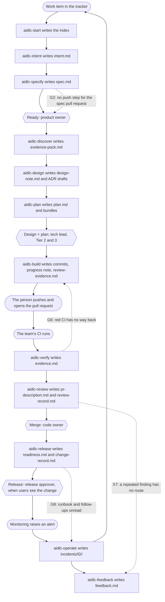

# pstack tool skills, aidlc removals, and the end-to-end flow

Read-only review, 2026-11-22. aidlc at local `main` (29a5b2a, aidlc 7.2.0). pstack read from the local copy in the
scratchpad (`pstack-src/pstack/skills/`). An aidlc path is relative to the repository root. `file:N` means line N.
This report does not repeat the first review (`pstack-vs-aidlc-review.md`). It cites that review's items as X1 to X10
where they overlap.

## Summary

- **Adopt three new practices.** `writing-plainly` takes the best of `technical-writing`, `unslop`, `bro`,
  `in-your-own-words` and `ketchup`. `explaining-code` takes `how`, `why` and `teach`. `driving-the-app` takes
  `create-verification-skill` and `maintain-verification-skill`, and closes change-list item B3.
- **Merge nine skills into existing aidlc skills.** These are `architect`, `benchmark-checklist`, `blast-radius`,
  `correct`, `interrogate`, `sharpen`, `show-me-your-work`, `swarm` and one idea from `no-comments`.
- **Skip the rest.** They need model routing, host features or shipped code. Or they weaken a gate, as `tdd` does.
- **The main constraint is the word limits.** `scripts/test_references.py` caps `aidlc-specify` at 1,800 words (it
  has 1,797), `aidlc-start` at 2,700 (2,675), `aidlc-plan` at 3,200 (3,185) and `aidlc-build` at 3,900 (3,880). Any
  new Load line in those four needs a cut first. The best cut is the placement paragraph that five stages copy
  (108 words each), because the index's "Runs in" column already says where each stage runs.
- **The flow has 17 broken or weak connections.** The worst ones: the story branch is never defined (G1). Document
  pull requests at Tier 2 and 3 have no push step (G2). An approval made in a pull request has no step that copies it
  into the file that expects it (G3). The `merged` row that `aidlc-review` marks does not exist on most routes (G4).
  `status.md` has no writer (G5). A red CI run has no way back to build (G6). "Users see the change" is never recorded
  before release (G7). Release outputs never reach operate (G8).

## 1. pstack tool skills: verdicts

The verdict is ADOPT (a new aidlc practice, or a reference inside one), MERGE (fold the best part into an existing
aidlc skill) or SKIP.

| pstack skill | What it does | aidlc equivalent | Verdict | aidlc name and kind | Where it loads, or the moment a person meets it |
|---|---|---|---|---|---|
| `bro` | Restates the last message in plain words, no jargon (`bro/SKILL.md:7`) | None. Closest: `aidlc-intent/SKILL.md:32` "Restate what you heard" | **ADOPT** | Step 3 of `writing-plainly` (practice) | Every stop message where a person decides (Ready, Design + plan, Merge, Release). A person can also ask for it by name |
| `technical-writing` | Prose standard: Diátaxis mode, Google style, STE and Global English rules (`technical-writing/SKILL.md:9-70`) | `writing-documentation/SKILL.md:22-32` says which documents to write, not how a sentence reads. `AGENTS.md` asks only "Write short sentences" | **ADOPT** the sentence layers; **MERGE** Diátaxis | `writing-plainly/references/sentences.md`. Diátaxis goes into `writing-documentation` step 1 | Every document a person approves: intent, spec, design note, ADR, plan, PR description, review record, readiness, incident record |
| `unslop` | Catalog of AI tells, with stable rule numbers (`unslop/SKILL.md:11-40`) | None | **ADOPT** | `writing-plainly/references/ai-tells.md` | The last pass on every document a person reads, and on each stop message |
| `in-your-own-words` | Restates the person's goal and problem (`in-your-own-words/SKILL.md:7`) | `aidlc-intent/SKILL.md:32`, `aidlc-plan/SKILL.md:52`, `aidlc-build/SKILL.md:36` already restate | **MERGE** into `writing-plainly` step 2 | Part of `writing-plainly` | A new plain summary for the product owner before Ready, in `aidlc-specify` (it has no restatement today) |
| `ketchup` | Catch-up reply. It opens with what waits on the person and gives each call its link, what it changes for users, the evidence, the risk and a pick (`ketchup/SKILL.md:9-33`) | The lanes coordinator's report (`parallel-lanes/SKILL.md:15`). The `waiting:` lines in the index (`aidlc-start/assets/story-index.md:18-19`) | **ADOPT** | `writing-plainly/references/hand-off.md`. It is the stop-message format and the format of the first review's `story-run` status mode (its rank 7) | The end of every stage. A tech lead with several stories open |
| `interrogate` | Adversaries try to break a change. A finding survives only when a run proves it (`interrogate/SKILL.md:9-25`) | `stress-testing-decisions/SKILL.md:21-31` uses a fresh context and evidence, but no runs. The reviewer agents are read-only (`agents/reviewer-bug.md:4`) | **MERGE** | `stress-testing-decisions` step 3 gains: "Settle an objection that an experiment can settle by a probe or a prototype in a throwaway worktree. Keep what the run shows." Skip the multi-model panel | `aidlc-design` step 4 and `aidlc-plan` step 4 at Tier 2 and 3, where it already loads |
| `blast-radius` | Finds what a change breaks beyond the diff. It proves the one fact the change is safe because of, and uses a five-step proof ladder (`blast-radius/SKILL.md:15-49`) | `aidlc-discover/SKILL.md:37-38` traces before any code. `agents/reviewer-bug.md` reads the diff. Neither names the safety fact or proves it | **MERGE** | `reviewing-code/references/blast-radius.md` (reviewing-code is one of the eight earlier practices, so a reference keeps its structure) | `aidlc-build` step 9 already loads `reviewing-code`. The author names the safety fact and the test that proves it in the evidence file. `reviewer-bug` reports the level the fact reached. The ladder ("ran it") also adds a level above FACT in discover |
| `correct` | Makes repeated agent mistakes impossible. The order is architecture, types, lint, test, docs, and each check is proved on a past mistake (`correct/SKILL.md:9-32`) | `aidlc-feedback/SKILL.md:28-49`, with the same ladder and the same proof | **MERGE** the missing lines | Into `aidlc-feedback` step 2 | Add: "assume the next contributor sees only the files it opened and copies the nearest example"; "delete the old way an agent would copy"; "when a pattern is common, fail only on new instances"; "delete a test that passes when the behaviour breaks". The trigger at review is X7 in the first review |
| `create-verification-skill` | Writes a per-repository guide to drive the real app: launch, doctor, drive, evidence, cleanup, a feature map, proved once end to end (`create-verification-skill/SKILL.md:9-44`) | None. `testing-in-browser` covers web pages only. B3 is open (`docs/design/2026-11-19-aidlc-6-change-list.md:73`) | **ADOPT** | `driving-the-app` (practice). The guide is a plain file the team owns, `docs/drive-the-app.md`, plus `docs/features/<feature>.md`. It is not a host skill folder, so it works on every host | Loaded by `aidlc-onboard` (write the guide and prove it once), `aidlc-verify` (a live row per criterion users see, marked "local only" unless CI runs it) and `aidlc-build` step 6 (a criterion users see outside a web page) |
| `maintain-verification-skill` | Keeps the guide and the feature map true: a source pass per feature, then one live pass. The outcome is clean, changed or blocked (`maintain-verification-skill/SKILL.md:11-39`) | `aidlc-onboard/SKILL.md:85` (A7 says to fix a stale path in the same pull request) | **MERGE** into the new practice | `driving-the-app/references/keeping-it-true.md`. The per-feature source readers are `explorer` briefs | Onboard A7. Also when verify finds that a drive no longer matches the app |
| `show-me-your-work` | Append-only decision log. A final audit checks that each row's evidence resolves (`show-me-your-work/SKILL.md:13-63`) | The decision log in the progress note (`aidlc-build/SKILL.md:41`; `aidlc-build/assets/progress-note.md:33`; ADR 0027). It is committed and read at Merge, which is better for a team | **MERGE** two rules | `agents/reviewer-compliance.md`: "each row's commit exists and each `file:line` resolves". `aidlc-build` step 7: "a row is never edited; a wrong row gets a new row that supersedes it" | Merge |
| `how` | A read-only sub-agent explains how a subsystem works (`how/SKILL.md:9-21`) | `agents/explorer.md:3` answers one precise question with citations | **ADOPT** inside `explaining-code` | `explaining-code` (practice), step "how" | `aidlc-review` step 5 (context first in the code owner's questions). `aidlc-discover` step 8 (the decision draft the tech lead reads). Any time a person asks "how does X work" |
| `why` | Answers why from the record: commits and PR discussions, the authors cited, inferences marked (`why/SKILL.md:9`) | None. Discover traces code, not history | **ADOPT** inside `explaining-code`, and **MERGE** one line into discover | `explaining-code` step "why". `aidlc-discover` step 3: "read the commits and pull requests that shaped each path you trace" | Discover, before legacy code changes. Any time a person asks "why is it this way" |
| `teach` | Explains a body of work plainly, built up diagram by diagram (`teach/SKILL.md:9-21`) | None | **ADOPT** as the frame of `explaining-code` | `explaining-code` steps 1, 3 and 5 | Onboarding a new engineer. A code owner new to the area |
| `sharpen` | Makes a task deeper: the rawest material, the methods, an outside check, and prototypes for choices an experiment can settle (`sharpen/SKILL.md:7-16`) | `aidlc-discover/SKILL.md:35` (one answerable question) | **MERGE** | `aidlc-discover` step 1: name the rawest evidence (runtime records, the code), not summaries, and what outside the session would show the answer is right. The prototype line goes to `stress-testing-decisions` (see `interrogate`) | Discover |
| `tdd` | Test first for a bug, but skip the test when it is impractical (`tdd/SKILL.md:11,22-26`) | `writing-tests/SKILL.md:31`; `aidlc-build/SKILL.md:40,79` (tests first, always) | **SKIP** | — | Its "skip when impractical" would weaken aidlc's tests-first gate. aidlc already has its good part |
| `no-comments` | Spawns a comment-deleting agent, and offers to encode each constraint comment as a check (`no-comments/SKILL.md:9-24`) | `writing-documentation/SKILL.md:29`; `simplifying-code/SKILL.md:30`; `reviewing-code/SKILL.md:54-55` | **MERGE** one idea, **SKIP** the agent | `writing-documentation` step 4: "a comment that says 'do not remove' or 'talk to X first' is a rule held by prose; propose the cheapest check that holds it, through `aidlc-feedback`" | Build, review |
| `swarm` | Fans out N workers. Each brief stands alone. Reports are PASS, ISSUES or BLOCKED. A result missing its named commit is respawned once, and a gap is not a pass (`swarm/SKILL.md:20-41`) | `parallel-lanes` (ADR 0025); one explorer per repository (`aidlc-start/references/several-repositories.md:5`) | **MERGE** the aggregate rules | Into the `parallel-lanes` coordinator report and the explorer dispatch in start step 5 | Coordinator report |
| `arena` | N candidates on several models; cross-judge, pick, graft (`arena/SKILL.md:9-60`) | `stress-testing-decisions` | **SKIP** | — | Model slugs and host config. aidlc's decision frame already asks for two real options |
| `architect` | Traces every system the change touches, sketches two shapes, and picks one owner per state and one way per task (`architect/SKILL.md:9-11`) | `aidlc-design/SKILL.md:48` (decision frame with two real options); `designing-apis` | **MERGE** | Into `aidlc-design/assets/decision-frame.md`: each option shows its types, signatures and module boundaries; prefer one owner per piece of state; redesign when workarounds repeat | Design, Tier 2 and 3 |
| `statechart` | Model-checks a TLA+ spec and draws a Mermaid statechart (`statechart/SKILL.md:11-21`) | None | **SKIP** the tool | — | It ships a script and installs Java and TLC (ADR 0024; "never install"). One idea is worth taking: for a change that adds states, the design note draws a Mermaid state diagram in the reader's words and lists the rules the product owner agrees to |
| `benchmark-checklist` | Vets a performance number: the limiter, both sides tuned, physical limits, errors, five or more alternating runs, end-to-end share, and whether the work happened (`benchmark-checklist/SKILL.md:9-38`) | `tuning-performance/SKILL.md:145-178` (keep or revert, noise). It lacks the limiter, tuning, limits, error count and "did it happen" checks | **MERGE** | `tuning-performance/references/benchmark-checklist.md`, named from its Step 4. `reviewing-code`'s performance axis says: a PR that claims a number is checked against it | Design step 9 already loads `tuning-performance`. Review of any PR that claims a speed-up |
| `create-formal-verification-skill`, `maintain-formal-verification-skill` | Writes and maintains a model check or proof for the riskiest code | None | **SKIP** for now | — | It needs tool installs. A Tier 3 option for later: `stress-testing-decisions` could name "a model check" for concurrency, retries and state machines |
| `figure-it-out` | Designs a playbook when none fits | Routes (`aidlc-start`) | **SKIP** | — | A route is the tech lead's decision (ADR 0027). First review section 4 |
| `automate-me` | Personal `<name>-mode` skill | — | **SKIP** | — | Team process. First review section 4 |
| `recall` | Rebuilds context from chat transcripts | State in git (`aidlc-build/SKILL.md:102`) | **SKIP** | — | The transcripts are host-specific and private |
| `reflect` | Edits skills from the transcript | `aidlc-feedback` | **SKIP** | — | The framework owners own the skills (`docs/operating-model/roles.md`) |
| `ketchup-video` | A video catch-up | — | **SKIP** | — | Rendering tools |
| `make-bot-ui` | A webhook UI for one bot product | — | **SKIP** | — | Product-specific |
| `setup-pstack` | Picks the model per role | — | **SKIP** | — | Host and model config |
| `typescript-best-practices` | TypeScript rules | `designing-apis/SKILL.md:318-371` | **SKIP** | — | aidlc is stack-neutral (Java and .NET evals). A team puts stack rules in its `AGENTS.md` Standards |

### 1.1 The three new practices

All three follow the practice sections (When to use, Steps, Checks, Stop if, Common excuses, Red flags, Rules). They
use gerund names and `metadata.kind: practice`. They have no `disable-model-invocation`, because
`scripts/test_loads.py:74-78` requires a loaded skill to be model-invocable.

**`writing-plainly`.** Use when writing anything a person reads: a document they approve, a stop message, a pull
request description, a commit body, or a reply to a question.
1. Name the reader and the decision they must make. (Diátaxis stays in `writing-documentation`. This practice is
   about the sentences.)
2. Restate the goal in your own words before writing to someone who asked for something (`in-your-own-words`).
3. After a dense message, restate it plainly, as one person to another (`bro`).
4. Write sentences by `references/sentences.md` (`technical-writing`'s Google, STE and Global English layers). Leave
   out its tabs rule and its repository specifics.
5. Run the last pass against `references/ai-tells.md` (`unslop`, with aidlc's own rule numbers).
6. A stop message follows `references/hand-off.md` (`ketchup`, re-based on git). Open with what waits on whom. Give
   each decision its link, what it changes for users, the evidence, the risk and your pick. Then give the exact words
   to resume. Read state from the index, the progress note and the pull request, never from the chat.
- Checks: a reader of that kind decides from the text alone; no rule in `ai-tells.md` is broken; every number has its
  source.
- Stop if: none of its own. This is never a gate. Slop is a low review finding, never a stop.

Person-facing moments, with the step that would load it:

| Moment | Stage and step | What `writing-plainly` adds |
|---|---|---|
| Ready, for the product owner | `aidlc-specify` step 6 (new two-line plain summary before asking) | A plain account of what users will get and what they will not, beside the AC IDs. Specify has no restatement today |
| Intent for the product owner | `aidlc-intent` step 8 | The sentence and slop pass on `intent.md` |
| Design + plan, for the tech lead | `aidlc-design` step 9; `aidlc-plan` step 8 | The ADR, the design note and the plan read plainly. The hand-off names the one pull request and who approves it |
| Merge, for the code owner | `aidlc-review` steps 2 and 7 | The PR description is a briefing read in under a minute. It links runs; it does not paste them (`technical-writing/SKILL.md:68`) |
| Release, for the release approver | `aidlc-release` step 5 | `readiness.md` and `change-record.md` |
| Incident, for on-call | `aidlc-operate` steps 5 and 6 | `incident.md` and `work-item.md` |
| Every stage's end | Start step 8 and each stage's last step | The `hand-off.md` stop message (fixes G10 and G11) |

**`explaining-code`.** Use when a person asks how or why something works, or when a stage must brief a person on an
area. Step 1: decide the few things they should walk away with, from why they ask. Step 2, how: brief the `explorer`
agent with one question. Step 3, why: read the commits and pull requests that shaped it, cite their authors, and mark
inferences. Step 4: start with a plain definition, then the mechanism. Step 5: build a diagram one part at a time.
Load it from `aidlc-discover` step 8 and `aidlc-review` step 5.

**`driving-the-app`.** Use when a change has a criterion users see, when a repository has no scripted way to drive
the real app, or when the guide has gone stale. It writes and keeps `docs/drive-the-app.md`: Launch (ready means
usable), Doctor (a read-only health check), Drive (real selectors or commands), Evidence (the real user path, the
action and the resulting state, side effects), Cleanup (kill what you started; evidence survives). It also writes
`docs/features/` with one file per user-facing feature. It proves the guide once, end to end. Rules: never weaken a
journey to make it pass; evidence never replaces the trusted CI run; it is marked "local only". Load it from
`aidlc-onboard` step 5, `aidlc-verify` step 2 and `aidlc-build` step 6.

### 1.2 What adopting them changes

| Change | Where | Risk and test impact |
|---|---|---|
| New Load lines | `scripts/test_loads.py:40-58` (the LOADS table) | Each stage's expected set changes. The test asserts the exact set (`:70-72`), so this edits an existing test assertion. **It needs the owner's approval** (AGENTS.md Boundaries) |
| The map's practice map | `skills/using-aidlc/SKILL.md:63-80` | `test_loads.py:31-34` requires every practice in the map. That is an addition, not a changed assertion |
| Word limits | `scripts/test_references.py:164` (specify, under 1,800), `:205` (start, under 2,700), `:233` (plan, under 3,200), `:294` (build, under 3,900) | Specify has 3 words of headroom. Start has 25, plan 15, build 20. Make a cut first (removal R3 below frees about 90 to 108 words per stage) |
| Routing | `scripts/routing_cases.json`; `scripts/route_check.py` flags descriptions at 0.75 similarity or above | `writing-plainly` and `writing-documentation` must not read alike. Give them different trigger words: sentences, plain words and AI tells against README, API reference and comments |
| Licence | `skills/NOTICE` | It holds only Addy Osmani's notice now. Add pstack's MIT notice ("Copyright (c) 2026 Lauren Tan") if `ai-tells.md` or `sentences.md` adapts pstack text. The owner's memory note says new skills use original words. The brief says adapting with credit is allowed. Ask the owner which one holds for these files |
| Version | `.claude-plugin/plugin.json` | A minor release: it adds skills and changes no route |

## 2. What aidlc should remove or merge

### 2.1 Inventory

| Kind | Count | Notes |
|---|---|---|
| Stage skills | 13 | 26,400 words in `SKILL.md`. Five have `references/` (Plan 26) |
| Practice skills | 16 | Eight earlier ones keep their own structure (`scripts/validate.py:40-42`) |
| Workflow, map | 2 | `parallel-lanes` (4,660 words), `using-aidlc` (1,777) |
| Agents | 6 | Every one is dispatched by a stage (`scripts/test_routes.py:35-38` checks this) |
| Templates | 42 files | 14 of them sit in five sets kept identical on purpose: `tiers.md` ×6, `story-index.md` ×2, `explorer-brief.md` ×2, `incident.md` ×2, `review-evidence.md` ×2 |
| Operating-model docs | 8 | 9,500 words |
| Starter files | 9 | Two duplicate onboard templates |
| History | 32 plans, 27 verification records, 14 designs, 28 ADRs | These ship with the plugin, because its source is `./` |

### 2.2 Candidates

| # | What | Where | Why it is redundant | Proposed action | Risk and the tests that pin it |
|---|---|---|---|---|---|
| R1 | **The "who decides" table, written nine times** | Source: `docs/operating-model/tiers-table.md:18-66` (and its six skill copies). Copies: `docs/operating-model/tiers.md:26-37`, `roles.md:20-40`, `adoption.md:107-135`, `workspace-and-repositories.md:62-70`, `lifecycle.md:16-29` (Decides and Gate columns), `routes.md:48-58` (Approvals column), `README.md:37-40` (Gates bullet), `skills/using-aidlc/SKILL.md:23-37` (Approved by column) | Every edit to a decision (Plans 24 to 26) had to touch each copy. `adoption.md`'s table is the fullest: it is the only one that also lists the kept decisions and where each is recorded | Keep `tiers-table.md` as the one source. Move `adoption.md`'s "Who approves what" rows for the kept decisions into it, under "Kept at every tier". Replace the copies in `tiers.md`, `roles.md`, `workspace-and-repositories.md` and `lifecycle.md` with a one-line link. Keep the map's Approved by column: a skill must read alone | `scripts/test_fewer_approvals.py:985-1012` pins wording in `tiers.md`, `routes.md`, `README.md`, the starter and the map. `test_routes.py:272-280` pins `lifecycle.md` and `workspace-and-repositories.md`. `test_fast_path.py:161`, `test_greenfield.py:98`, `test_docs.py:88,160` and `test_fewer_approvals.py:616-617,719` pin `lifecycle.md`. **Owner approval needed** |
| R2 | **The route-to-stages table, six copies** | `skills/using-aidlc/SKILL.md:47-57`; `docs/operating-model/routes.md:46-58`; `skills/aidlc-start/SKILL.md:91-118`; `README.md:71-93`; `docs/operating-model/workspace-and-repositories.md:13-21`; `docs/operating-model/lifecycle.md:37-39` | X3 in the first review found four. The workspace doc's kind-of-work table is a fifth, and `lifecycle.md` a sixth | As the first review's rank 2. The map is the one source. `routes.md` keeps the diagrams. The workspace doc links to the map | `test_routes.py:263-270` (route codes). `test_fewer_approvals.py:1040-1045` (the S row in `routes.md`) |
| R3 | **The placement paragraph, copied in nine stages** | "Where this runs: read the story's index first..." (108 words) in `aidlc-intent:26`, `aidlc-specify:30`, `aidlc-discover:30`, `aidlc-design:38`, `aidlc-release:27`. The part-level paragraph (90 words) in `aidlc-plan:45`, `aidlc-build:30`, `aidlc-verify:24`, `aidlc-review:32` | The story index already has a "Runs in" column per row (`aidlc-start/assets/story-index.md:29-31`), and `aidlc-start` step 7 fills it. The stage reads its own row anyway | Shorten each to: "Where this runs: the 'Runs in' cell of this stage's row in the story's index. Run there; started elsewhere, name the right folder and stop. No index: run `aidlc-start` first." Keep the two path patterns. This frees about 70 words per stage, which is the headroom section 1.2 needs | No test pins the paragraph (`test_routes.py:50` checks only that operate and feedback do not have it). Evals that start a stage in the wrong folder must still pass. Run `route-*` evals |
| R4 | **The "People decide; you record" rule** | 199 words, identical in 12 stages (`aidlc-build/SKILL.md:101` and others) | 2,400 words in all. X6 in the first review | **Keep for now.** It is pinned identical (`scripts/test_instructions_first.py:408-427`; `scripts/test_recording.py:33-45`), and a skill must read alone. If the first review's Principles section lands, the paragraph can become one line plus a name. That needs the owner's approval for both tests | High: two tests |
| R5 | **Duplicate sentences in two Gates** | `aidlc-design/SKILL.md:80` says "For a story across several repositories, Decision 2..." twice. `aidlc-plan/SKILL.md:93` does the same | The same rule, said twice in one paragraph | Delete the second sentence in each | `test_fewer_approvals.py` pins the "still one decision" sentence once. Keep that one |
| R6 | **Verify drafts the PR description, review completes it** | `aidlc-verify/SKILL.md:35,41`; `aidlc-review/SKILL.md:38`; `skills/committing-changes/SKILL.md:41`; `README.md:86` | Two owners for one file. Verify's draft has no path (G14) | Review owns the description (it already fills `assets/pr-description.md`). Delete verify step 6. Change the two mentions | No test pins verify step 6. The README row changes |
| R7 | **`status.md`, a vestige of the removed `story_status.py`** | `aidlc-start/references/several-repositories.md:13`; `aidlc-design/assets/coordination-plan.md:24`; `aidlc-specify/references/amendment.md:25`; `aidlc-design/references/amendment.md:16`; `aidlc-onboard/assets/workspace.md:34-36`; `starter/workspace/WORKSPACE.md:29`; `starter/workspace/stories/README.md:15,30`; `docs/operating-model/routes.md:128,262,311`; `workspace-and-repositories.md:49` | No stage step writes it (G5). Release computes the same facts from git (`aidlc-release/SKILL.md:32`) | Either give it an owner: `aidlc-release` step 1 writes it with the Parts table, and the first review's `story-run` status mode writes it too. Or delete it and point to the release Parts table. The first is cheaper, because no test changes | Deleting it hits `test_routes.py:171-174, 339, 349`. **Owner approval needed for deletion** |
| R8 | **Starter rules files that duplicate onboard's templates** | `starter/repo/AGENTS.md` = `skills/aidlc-onboard/assets/agents-md.md` with `<…>` placeholders. `starter/workspace/WORKSPACE.md` = `skills/aidlc-onboard/assets/workspace.md` | The README says to copy the starters and then run onboard (`README.md:18-19`). Onboard "never overwrites an existing `AGENTS.md`" (`aidlc-onboard/SKILL.md:113`). So the team first copies a placeholder file, and then onboard proposes a diff against it | Keep `CODEOWNERS`, `CLAUDE.md` and the settings in `starter/`. Drop the two rules files. Onboard writes them from its assets | Many tests read both copies: `test_gates.py:7`; `test_gates_hold.py:108,192`; `test_fewer_approvals.py:579,987,1005`; `test_instructions_first.py:120,189,271,284`. **Owner approval needed.** Medium value |
| R9 | **Legacy template headers from the harness's `render` command** | YAML `id/title/stage/guide/fields` at the top of `skills/aidlc-design/assets/coordination-plan.md:1-7`, `skills/aidlc-onboard/assets/workspace.md:1-7` and `skills/aidlc-release/assets/compat-matrix.md:1-7` | No skill or script reads them. The other templates open with `<!-- aidlc template: … -->` | Replace each with the one-line comment | No test pins them |
| R10 | **"Context gaps noticed (B5)"** | `skills/aidlc-build/assets/progress-note.md:44-45` | B5 was dropped (`docs/design/2026-11-19-aidlc-6-change-list.md`, section 6). No step fills it and no stage reads it (G13) | Wire it (build step 10 fills it, and `aidlc-onboard` A7 reads repeats) or delete it. Drop "(B5)" either way | A fixture string in `test_route_and_log.py:632` only |
| R11 | **The parked demo** | `docs/demo/` (`shipment-tracking.md`, `probe.py`, `page-check.mjs`, `evidence/`) | Decision D4 parked the demo. `probe.py` expects the plugins `aidlc` and `aidlc-practice`, which ADR 0018 merged. It is code in an instructions-only package, and it ships with the plugin | Move it under a tag (`demo-v1`), with a pointer in `docs/archive/`, as `checks-v1` did | No test reads `docs/demo` |
| R12 | **A stale operating-model page** | `docs/operating-model/autonomy-and-maturity.md` ("This framework installs rungs 2–5"; "harness templates") | After ADR 0024 aidlc installs no checks or telemetry. Only `adoption.md:19,97` links it | Move "The autonomy check" into `adoption.md` Phase 4. Delete the rest | No test |
| R13 | **`tiers.md` beside `tiers-table.md`** | `docs/operating-model/tiers.md` (330 words) | Its "Who decides" section is a copy (R1). Its rating guide and examples belong beside the table | Merge into one page `tiers.md`, keeping the table's anchor | `test_fewer_approvals.py:174,213,987,1005` read `docs/operating-model/tiers.md`; the comment in `tiers-table.md:1` names the file |
| R14 | **ADR status lines** | `docs/adr/0001`, `0002-github-trusted-ci`, `0003`, `0004`, `0007` read "Accepted", although ADR 0024 removed what they built. ADR 0024 supersedes only 0019 (`docs/adr/0024-instructions-first.md:5`). Two ADRs are numbered 0002 | A reader takes a dead decision as live | Add "Superseded in part by ADR 0024" to each status line. Leave the 0002 pair, but note it in the ADR index | Low. `test_routes.py:351-353` pins only the 0019 status and the 0015 amendments |
| R15 | **The README commands table** | `README.md:71-93` (14 rows) | A copy of the map's lifecycle table | After the first review's `story-run`: one line plus a pointer to the map | Low |

**Keep, and do not remove.**
- The six `tiers.md` copies, and the paired copies of `story-index.md`, `explorer-brief.md`, `incident.md` and
  `review-evidence.md`. A skill may name only its own files (`scripts/validate.py:66-68`), and the copies let each skill
  load alone. Tests keep them equal (`test_fewer_approvals.py:16,130`; `test_handoffs.py:48-79`;
  `test_fewer_approvals.py:549-551`).
- `reviewer-compliance` re-checking what build did. Fresh-context checking is the point.
- `stress-testing-decisions` beside `aidlc-design` step 4. The design argues against itself, and the practice adds a
  fresh context at Tier 2 and 3.
- The plans, verification records and designs. They are history and cost nothing at run time. A team that minds the
  plugin's size can move them to a tag later.

## 3. The end-to-end flow

### 3.1 The whole flow, with the gaps

A hexagon is a person's decision. A stadium is an external touch point. A dotted arrow is a connection that is
missing or weak.

### 3.2 Tier 1 story, route F1, one repository

| # | Stage skill | Practices and agents | Reads | Writes | People and their decision | External touch points |
|---|---|---|---|---|---|---|
| 1 | `aidlc-start` | `using-aidlc` (step 6) | The work item; `AGENTS.md` (the Standard changes section on the default branch); `assets/tiers.md` | `plans/<KEY>/README.md`: SOURCE, KIND, ROUTE with its facts, LEVEL, one row per stage (`aidlc-start/SKILL.md:85-94`) | None decides. The product owner owns the story. The tech lead owns the route | The tracker is read through its tool, or the person pastes the item. **No branch is created or named (G1)** |
| 2 | `aidlc-intent` (if needed) | — | The index, the work item, the linked evidence | `plans/<KEY>/intent.md` | The product owner's acceptance is part of Ready. No stop (`aidlc-intent/SKILL.md:48`) | It offers a comment on the work item and asks first |
| 3 | `aidlc-specify` | — | The intent, the work item's criteria | `spec.md`; the index's CURRENT line; the ROUTE copied into the spec header (`:44`) | **Ready**: the spec owner's word in the session, or their own tracker entry, checked. The AI writes "Spec v1 approved by … · route F1 (shown)" (`:58`) | Tracker check. The permalink at a commit |
| 4 | `aidlc-discover` (when the tier or an unknown asks) | `explorer`; `designing-apis`; `writing-tests` | The index, `AGENTS.md`, the codebase map | `evidence-pack.md` with a draft DECISION | None at Tier 1. The code owner sees it at Merge (`:51`) | Runtime evidence comes only from a person |
| 5 | `aidlc-design` | `securing-code`, `migrating-safely` and others only on a yes | The spec, the evidence pack | `design-note.md` "none needed", RECORDED BY "stated at Tier 1" (`:43`) | None. A yes raises the tier and goes back to Ready | — |
| 6 | `aidlc-plan` | `explorer`; `writing-tests`; `checking-official-docs`; `testing-in-browser`; `using-aidlc` (USE SKILLS) | The spec, the design note, the evidence pack, the map | `plan.md` (APPROVAL "none: stated at Tier 1", `assets/plan.md:39`) and `bundle-<n>.md` | None, unless the slices are independent: then the tech lead approves (ADR 0025) | — |
| 7 | `aidlc-build`, one per slice | Each USE SKILL; `writing-tests`; `testing-in-browser`; `committing-changes`; `debugging-failures`; `checking-official-docs`; `reviewing-code`; agents `reviewer-compliance` and `reviewer-tests` | The bundle, the plan, the spec, `git log` | Commits; `progress-<n>.md` with the restatement and the decision log; `review-evidence.md`; the build row | Checkpoints by MODE (the engineer). A new dependency, an assertion change or a Quality bar exception stops | **The person pushes and opens the pull request** (`:44`). The pull request title is given only for parts (`:30`) |
| 8 | `aidlc-verify` | — (`testing-in-browser` rows for web criteria) | The CI results, the spec, the plan's test map, `review-evidence.md` | `evidence.md`; a PR description draft with no path (G14) | None (`:44`) | **The team's CI**. A red run is "report it" only (G6) |
| 9 | `aidlc-review` | `reviewing-code`; `securing-code` when needed; agents `reviewer-bug`, `reviewer-security`, `reviewer-compliance`, `reviewer-tests` | The pull request, `evidence.md`, spec, plan, bundles, progress notes, `tiers.md`, the rules on the default branch | `review-evidence.md`, `pr-description.md`, `review-record.md`, `security-review.md` when needed | The engineer decides each finding. **Merge**: a code owner who is neither author nor pusher, after a non-author PASS. They read the decision log and check the ROUTE facts at Tier 1 (`:62`) | Posting to the pull request asks first. The approval is in the review tool. The AI marks a `merged` row that this route has no row for (G4). **The person merges** |
| 10 | `aidlc-release` | `adding-observability`; `migrating-safely`; `committing-changes`; `writing-documentation` | The merged pull request and its evidence, the flag, monitoring, the rollback | On branch `release/<KEY>`: `readiness.md`, `change-record.md`, `release-runbook.md`, `follow-ups.md` | **Release** only when users see the change. Nothing earlier records whether they do (G7). The records merge in their own pull request, an approval the table does not list (G9) | Change management; the release pipeline deploys; a person turns flags on |
| 11 | `aidlc-operate` | `ops-diagnoser`; `adding-observability` | The alert, the runbook, masked logs, "the release record", with no path (G8) | `incidents/<ID>/` files; `work-item.md` | On-call contains; the product owner accepts the follow-up | Monitoring; the incident tool; the tracker (the person raises the item) |
| 12 | `aidlc-feedback` | `writing-tests`; `building-ci-pipelines`; `adding-observability`; `writing-documentation` | The incident's Prevention section, or repeated findings | `feedback.md`; a draft row in the "Rules and what enforces them" table of the team's `AGENTS.md` | The owner of each source | The team's CI and linters |

### 3.3 Tier 2 story, route F1, one repository: what differs

| # | Stage | Difference | Gap |
|---|---|---|---|
| 3 | `aidlc-specify` | Ready is the approval of the spec's own pull request, which merges first (`aidlc-specify/SKILL.md:58`; ADR 0020). The AI writes the Approval record and the tracker entry from it | Nothing says the person pushes and opens that pull request (G2). Nothing says which session or commit writes the Approval record after the approval, before or after the merge (G3). The branch it travels on is never named (G1) |
| 4 | `aidlc-discover` | Evidence pack items 1 to 5 are required. "Proceed" is decided with the design and the plan | — |
| 5 | `aidlc-design` | Every step. Decision frames; `stress-testing-decisions`; `checking-official-docs`; contract-first with `designing-apis` and `writing-tests`; consumers approve a contract change; the product owner approves a wireframe in the same pull request | The design pull request is the plan's pull request; the design does not say who opens it |
| 6 | `aidlc-plan` | MODE is hands-on, or delegate with checkpoints. **Design + plan**: one pull request approval by the tech lead, who also checks the ROUTE facts. It merges first, and the build starts from the merged bundle | The APPROVAL line has the same issue as G3 |
| 7 | `aidlc-build` | The bundle must equal the copy on the default branch (`aidlc-build/SKILL.md:32,55`). A CHECKPOINT stops before each contract step | The code branch must start from the default branch after the plan merges. Nobody says so (G1) |
| 8-9 | verify, review | Contract tests and the integration environment. The code owners of every affected area | — |
| 10 | `aidlc-release` | A flag where users see the change; the release approver decides only when users see it | G7 |

### 3.4 Route S, a standard change

| # | Stage | Reads | Writes | People | External | Gap |
|---|---|---|---|---|---|---|
| 1 | `aidlc-start` (steps 2 and 7, `references/route-s.md`) | `git show origin/<default>:AGENTS.md` Standard changes; `assets/tiers.md` | Index rows build, verify, review, release (when users see the change) and `merged` (`route-s.md:9`); `plans/<KEY>/standard.md` | **Ready**: the engineer confirms the brief and its tier. The AI writes the CONFIRMED line (`aidlc-start/SKILL.md:106-113`) | Tracker read; a `git fetch` | The step does not say where the CONFIRMED line is committed, or on which branch (G1) |
| 2 | `aidlc-build` (slice `standard`) | `standard.md` as the bundle | Commits; a progress note; `review-evidence.md` with the STANDARD line | A listed recipe class has no recipe pause (`aidlc-build/SKILL.md:39`) | A package in a lock file counts as a new dependency | — |
| 3 | `aidlc-verify` | The LIMITS lines | `evidence.md` | None | CI | G6 |
| 4 | `aidlc-review` | `standard.md`, the STANDARD line | Review files | **Merge**: the code owner approves `standard.md` with the change (`aidlc-review/SKILL.md:38`) | Review tool | Route S does have its `merged` row |
| 5 | `aidlc-release`, only when users see the change | — | — | Release approver | Change management | G7 |

### 3.5 A story across several repositories (route F2, at least Tier 2)

| # | Where | Stage | Writes | People | External | Gap |
|---|---|---|---|---|---|---|
| 1 | Workspace root (home repository) | `aidlc-start` with one `explorer` per repository (`references/several-repositories.md:5`) | `stories/<KEY>/README.md`: rows intent, specify, discover, design, release, and the line "parts: see `status.md`" (`:13`) | — | Tracker | **No step ever writes `status.md` (G5)** |
| 2 | Root | `aidlc-intent`, `aidlc-specify` | `stories/<KEY>/intent.md`, `spec.md` (each criterion names its repository) | **Ready**: the spec's pull request in the home repository | Home code host | G2, G3 |
| 3 | Root, read-only for repositories | `aidlc-discover`, `aidlc-design` (`references/several-repositories.md`) | Evidence pack; design note; ADR drafts; `contract/` drafts; `coordination-plan.md` | **Design + plan, part 1**: the tech lead on the home design pull request; consumers on a contract change | Home code host | The root session cannot run tests, so checks are drafted and shown red in slice 1 (`aidlc-design/SKILL.md:55`) |
| 4 | Each repository | `aidlc-plan` (`references/several-repositories.md:9-15`) | Part index `plans/<KEY>/README.md` (rows plan, build, verify, review, `merged`); `criteria.md` copied at the home commit; plan and bundles with PINS | **Design + plan, part 2**: the same tech lead on the part's plan pull request, titled `[<KEY>] part n of m, plan vN` | That repository's code host | — |
| 5 | Provider repository | A person applies the published contract (plan step 7) | Tag `api-v…` | The provider's code owner | `git ls-remote --tags`; `oasdiff` in CI (`designing-apis`) | — |
| 6 | Each repository | `aidlc-build`, `aidlc-verify`, `aidlc-review` | As F1, on `feat/<KEY>-<part>` | **Merge**: each part's own code owners | Each CI and review tool | The root does not learn when a part merges until release (G5) |
| 7 | Root | `aidlc-release` | Parts table from git (`aidlc-release/SKILL.md:32`); `compat-matrix.md`; the integration check from the plan's VERIFY row; flags on in order | **Release**: the release approver, when users see the change | Change management; flags; monitoring | G7, G8 |

### 3.6 External touch points: owner and instruction

| Touch point | Who acts | Instruction today | Gap |
|---|---|---|---|
| Tracker: read the item | AI, through the tool or a paste | `aidlc-start/SKILL.md:24-25` | — |
| Tracker: comments and approval entries | AI asks first, then posts | `aidlc-intent:40`, `aidlc-specify:58`, `aidlc-plan:93` | — |
| Tracker: status transitions | A person | "You never change a work item's status" (`aidlc-intent/SKILL.md:48`). Nothing tells the person when to move it | G11 |
| Branches | A person or the AI | Named for code (`aidlc-plan/SKILL.md:90`) and parts (`:45`). Never for the spec or design pull requests, or for the story's first commit | G1 |
| Push and open a pull request | A person | Only for code (`aidlc-build/SKILL.md:44`) | G2 |
| Pull request description | AI drafts; posting asks first | Verify and review both (`aidlc-verify:35`; `aidlc-review:38`) | G14 |
| CI | The team's | `aidlc-verify` reads it. A red run is "report it" (`:47`) | G6 |
| Review tool approval | Code owner | `aidlc-review/SKILL.md:45-53` | G4 |
| Merge | A person | `aidlc-review/SKILL.md:53` | — |
| Change management | Release approver | `aidlc-release/SKILL.md:50` | The step that files `change-record.md` in the tool is implicit. The approver gives the record's ID |
| Deploy and flags | A person or the pipeline | `aidlc-release/SKILL.md:37,75` | — |
| Monitoring and alerts | Owning team, on-call | Release checks that monitoring is "in place" (`:32`). Stop criteria are written (`:34`), but no step says each criterion becomes an alert or dashboard with an owner. H1 is open | G8 |
| Incident tool | On-call | `aidlc-operate/SKILL.md:28` | — |

### 3.7 Broken and weak connections

| # | Connection | Evidence | Proposed fix |
|---|---|---|---|
| **G1** | **The story branch is never defined.** Intent, specify and plan write "on the story branch". No stage creates the branch, names it, or says which branch carries the spec pull request, the design and plan pull request, and the code pull request at Tier 2 and 3. Route S's CONFIRMED line has no branch either | `aidlc-intent/SKILL.md:45`; `aidlc-specify/SKILL.md:55`; `aidlc-plan/SKILL.md:90` (only the code branch is named); `aidlc-start/SKILL.md:85-89` (the index is written "where this session runs") | `aidlc-start` step 7 writes a BRANCH line in the index. At Tier 1, one branch `<type>/<KEY>-<slug>` carries the documents and the code. At Tier 2 and 3, `docs/<KEY>-spec` merges first, then `docs/<KEY>-plan`, then `<type>/<KEY>-<slug>` starts from the default branch. Every stage reads it |
| **G2** | **Document pull requests have no push step.** At Tier 2 and 3 the spec, and the design with the plan, merge first in their own pull requests. Only build says "the person pushes and opens the pull request". Also, no stage says what the description of a document pull request holds | `aidlc-specify/SKILL.md:58`; `aidlc-design/SKILL.md:80`; `aidlc-plan/SKILL.md:93`; `aidlc-build/SKILL.md:44` | The last step of specify (Tier 2 and 3) and of plan says: "Tell the person to push the branch and open the pull request `[<KEY>] spec vN` (or `design + plan vN`). Its description is the document's 'For the reviewer' section, with links" |
| **G3** | **An approval made in a pull request is expected in a file, with no step to copy it.** The spec's Approval record, the plan's APPROVAL line, the design's APPROVED line and the tracker entry are written "from" a pull request approval. Only `aidlc-review` step 8 says when and how (a final commit, then re-approval where the host dismisses stale approvals). A record written after the merge needs another pull request | `aidlc-specify/SKILL.md:58`; `aidlc-plan/SKILL.md:93`; `aidlc-design/SKILL.md:80`; the pattern in `aidlc-review/SKILL.md:45-53` | Choose one rule for document pull requests. Either the pull request approval is the record, and the file says "approved on pull request <n>; see it there" (one owner per fact, ADR 0022), with the next stage checking it in the review tool and writing the tracker entry. Or reuse review step 8's final-commit pattern. The first needs no extra commit |
| **G4** | **`aidlc-review` marks a `merged` row that most routes never write.** The template describes the row. Start writes it only on route S. Parts and independent slices get one from plan | `aidlc-review/SKILL.md:45-55`; `aidlc-start/assets/story-index.md:20-24`; `aidlc-start/SKILL.md:91-104` (F1, D2, D1, F0 rows have no `merged`); `aidlc-start/references/route-s.md:9`; `aidlc-plan/references/several-repositories.md:11` | `aidlc-start` step 7 adds a `merged` row after `aidlc-review` on every route. Add an eval grader to `route-f1-start` for it |
| **G5** | **`status.md` has no writer.** The root index points to it. The coordination plan, the amendment steps and `WORKSPACE.md` say the AI at the root writes it "after any part moves", but no stage runs at the root when a part moves | `aidlc-start/references/several-repositories.md:13`; `aidlc-design/assets/coordination-plan.md:24`; `aidlc-specify/references/amendment.md:25`; `aidlc-onboard/assets/workspace.md:34-36` | `aidlc-release` step 1 writes `status.md` when it fills the Parts table. The first review's `story-run` status mode writes it on demand. Or delete it (R7, needs owner approval for three tests) |
| **G6** | **A red CI run and a review finding have no way back to build.** Verify only reports a red check. Review records "fixed (with the commit)", but no stage says who writes that commit, under which bundle, or that verify and review run again. Build's "When to use" covers only a planned slice | `aidlc-verify/SKILL.md:47`; `aidlc-review/SKILL.md:40`; `aidlc-build/SKILL.md:27`; `docs/operating-model/lifecycle.md:47` ("a CI failure returns to the inner loop") | Verify's Stop if and review step 4 say: "A fix is a new step in the same slice: run `aidlc-build` on that slice, inside its MAY CHANGE, loading `debugging-failures`. The reviewer verdicts are then void (the verdict rule), so verify and review run again." Build's "When to use" adds "a fix after a red CI run or a review finding" |
| **G7** | **"Users see the change" decides Release, but nothing records it before release.** No spec, plan or brief line says whether users see the change or which flag hides it. So the release stage judges alone whether a person must decide | `docs/operating-model/tiers-table.md:29-34`; `aidlc-release/SKILL.md:50`; `aidlc-plan/assets/plan.md:19` (only ROLLBACK names a flag) | Add a `USERS SEE` line (yes; no; behind flag `<name>`, off) to the spec header and to the F0 and S briefs. It is set at Ready, and the code owner checks it at Merge. Release reads it |
| **G8** | **Release outputs never reach operate.** Release writes `release-runbook.md` and the stop criteria in `plans/<KEY>/` on `release/<KEY>`. Operate reads "the runbook" and "the release record" with no path, and works in `incidents/<ID>/` without a story key. `follow-ups.md` (flag removal, with an owner and a date) is read by no stage. No step ties a stop criterion to an alert | `aidlc-release/SKILL.md:34,36,39,44-47`; `aidlc-operate/SKILL.md:27-31` | Release step 3 names, for each stop criterion, the alert or dashboard that shows it and its owner (`adding-observability`). Release step 8 says where the runbook lives (a new "Runbooks" line in `AGENTS.md` Where to look). Operate step 1 finds the story key from the deploy or flag change and reads `readiness.md` and the runbook by path. Release step 5 drafts each follow-up as a work item the person raises, as operate step 6 does |
| **G9** | **The release records pull request is an approval the table does not list.** At Tier 1, when users do not see the change, release still writes four files on `release/<KEY>`, which merge "in their own small pull request" | `aidlc-release/SKILL.md:44-47,50`; `docs/operating-model/tiers-table.md:24-31` | When no Release decision is needed, release writes `readiness.md` on the code branch before Merge, so the code owner sees it with the change. It marks the release row "not needed: users do not see it (USERS SEE: no)". The separate pull request stays for a real Release |
| **G10** | **Six stages name no next stage.** Specify, discover, plan, build, verify and review end without saying what runs next or where. Only the map's Next column and start step 8 do. This is the hand-off form of X1 | `grep` finds no "next stage" in those six; `skills/using-aidlc/SKILL.md:23-37`; `aidlc-start/SKILL.md:134` | Without the first review's `story-run`: each stage's last step reads "Tell the person the next row of the index, where it runs, and what waits on whom", in `writing-plainly`'s hand-off format. With `story-run`, it is the same message at each stop |
| **G11** | **Tracker status has no owner prompt.** Every stage forbids the AI to move the item, and no stage tells the person when to move it (at Ready, at the pull request, at merge, at release) | `aidlc-intent/SKILL.md:48`; `docs/operating-model/workspace-and-repositories.md:48` | The hand-off message names the tracker move the person may make now |
| **G12** | **Two practices no stage loads.** `building-user-interfaces` and `simplifying-code` | `scripts/test_loads.py:40-58`; X5 in the first review | `aidlc-design` step 2 loads `building-user-interfaces` for a new screen. `aidlc-build` step 6 loads it for a UI change. `aidlc-review` step 4 loads `simplifying-code` when a finding is needless complexity. This changes the LOADS table, so it needs the owner's approval |
| **G13** | **A template section no step fills and no stage reads.** "Context gaps noticed (B5)" | `skills/aidlc-build/assets/progress-note.md:44-45` | Build step 10 fills it ("what you did not know" is already in its report). `aidlc-onboard` A7 reads repeated gaps. Or delete it (R10) |
| **G14** | **Verify's PR description draft has no path, and two stages own it.** Review "starts from" a draft that is written nowhere | `aidlc-verify/SKILL.md:35,41`; `aidlc-review/SKILL.md:38,58` | Review owns `pr-description.md` (R6) |
| **G15** | **The PR description template has no Tier 1 form for the plan.** It always reads "approved by {{who}}", while the plan template has "none: stated at Tier 1" | `skills/aidlc-review/assets/pr-description.md:35`; `skills/aidlc-plan/assets/plan.md:39` | Copy the plan template's Tier 1 form |
| **G16** | **Part-level stages tell you to mark the root index.** Verify and review say "or `stories/<KEY>/README.md` at a workspace root", but they never run at the root, and the root index has no part rows | `aidlc-verify/SKILL.md:36-37`; `aidlc-review/SKILL.md:44-45`; `aidlc-start/references/several-repositories.md:13` | Say "the part index `plans/<KEY>/README.md`" only |
| **G17** | **An approved document without the reviewer section.** `incident.md` is approved by on-call in a pull request, but it does not open with "For the reviewer", which AGENTS.md requires | `skills/aidlc-operate/assets/incident.md:1-10`; `AGENTS.md` Standards | Add the section to both identical copies (`test_handoffs.py:78` keeps them equal) |

Stages that cannot learn a decision they need: G7 (release cannot learn whether users see the change), G3 (plan and
design cannot tell, from the file, whether Ready or Design + plan was approved at Tier 2 and 3), and G5 (the root
cannot learn when a part merged).

Agents: none is orphaned. `explorer` is dispatched by start, discover, plan, onboard and `stress-testing-decisions`.
`ops-diagnoser` is dispatched by operate. The four reviewers are dispatched by build and review. Templates: every
template is named by its skill. Three outputs have no template: `follow-ups.md` in release, and `signal-log.md` and
`diagnosis.md` in operate. That is fine, but `follow-ups.md` has no reader (G8).

## 4. Suggested order

1. **Fix wave, no new skill.** G1, G2, G3 (as one rule), G4, G5 (release writes `status.md`), G6, G7, G14 to G17,
   R5, R6, R9 and R10. Do R3 first, because it frees the words that the fixes need under the limits in
   `scripts/test_references.py`. None of these changes an existing test assertion, except where marked.
2. **`writing-plainly`.** It also gives the hand-off format for G10 and G11, and for the first review's `story-run`.
   Ask the owner about the NOTICE wording and the LOADS change.
3. **`explaining-code`**, and the merges from section 1: interrogate and sharpen, blast-radius, benchmark-checklist,
   architect, correct, show-me-your-work and swarm.
4. **`driving-the-app`** with the first review's rank 4 (B3).
5. **Docs consolidation** R1, R2, R8, R11 to R15, after the owner approves the pinned-wording test changes.
